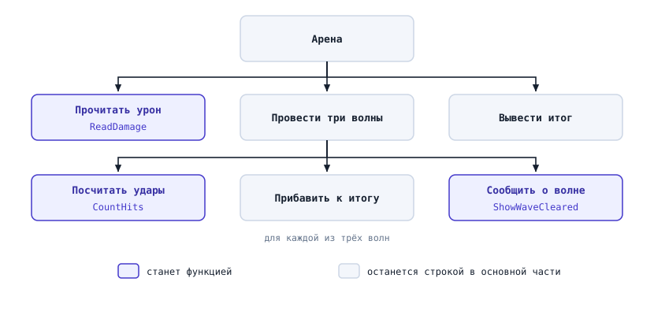
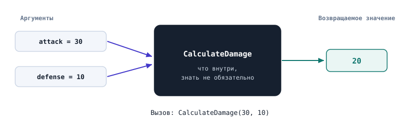
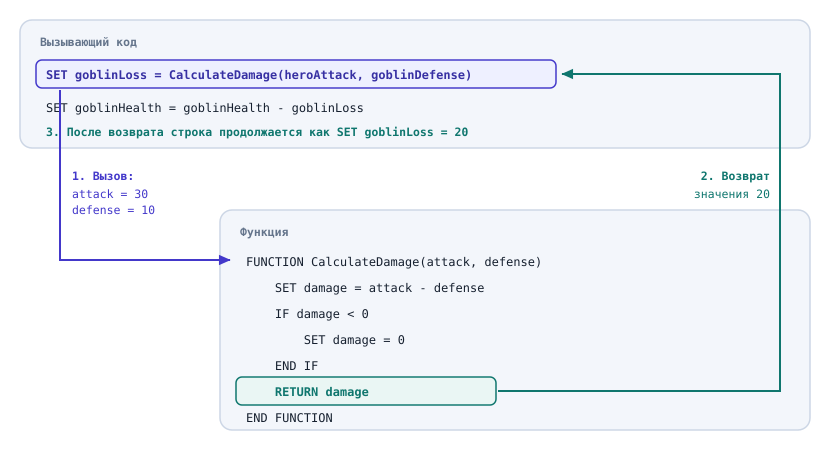
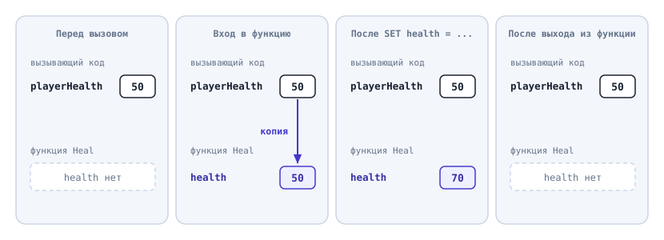
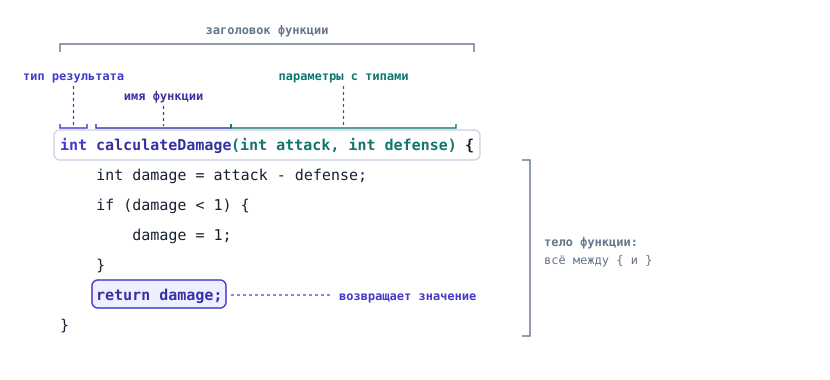
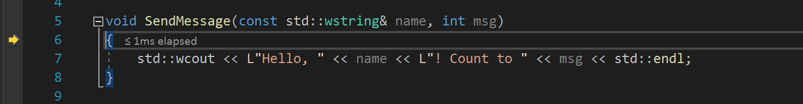

# Процедурное программирование. Функции

## Содержание

## Вопросы для самопроверки

1. Какие две проблемы появляются, когда одна и та же формула записана в программе в пяти местах?

2. Чем параметр функции отличается от аргумента? Назовите параметры и аргументы в этом фрагменте:

   ```text
   FUNCTION CalculateDamage(attack, defense)
       ...
   END FUNCTION

   SET loss = CalculateDamage(30, 12)
   ```

3. Что делает функция, когда выполнение доходит до `RETURN`? Выполнятся ли строки, которые стоят после него?

4. Что выведет эта программа и почему?

   ```cpp
   void heal(int health) {
       health = health + 20;
   }

   int main() {
       int playerHealth = 50;
       heal(playerHealth);
       std::cout << playerHealth << '\n';

       return 0;
   }
   ```

5. Почему функция, которая вычисляет урон, должна возвращать его, а не выводить на экран?

6. Функция `calculateDamage` определена в файле ниже функции `main`, а вызывается из `main`. Что скажет компилятор и как это исправить двумя способами?

7. Чем шаг с заходом (F11) отличается от шага с обходом (F10), если программа остановлена на строке с вызовом функции?

8. Какое значение вернёт функция при `attack = 10` и `defense = 15`? Почему компилятор выдаст здесь предупреждение?

   ```cpp
   int calculateDamage(int attack, int defense) {
       if (attack > defense) {
           return attack - defense;
       }
   }
   ```

## О чём мы говорили в прошлой главе?

В прошлой главе мы разобрали, как выполняется программа с циклами, какие ошибки в ней встречаются и как их искать: от таблицы трассировки до отладчика. В конце главы, в примере "Отлаживаем арену", получилась программа на 30 строк. В ней были:

- проверка ввода,
- внешний цикл по волнам,
- внутренний цикл боя,
- итоговый счётчик.

Мы тогда оставили одно обещание. В разделе "Выполнение по шагам" шестой главы мы познакомились с командой "шаг с заходом" и сказали, что её отличие от шага с обходом станет видно, когда программа будет разбита на отдельные именованные части. Эти части называются функциями, и о них эта глава.

Все наши программы до сих пор были написаны одним куском внутри `main`. Пока в программе 30 строк, это терпимо. В игре их тысячи, и одним куском такую программу уже нельзя ни прочитать, ни проверить, ни изменить. Глава состоит из двух частей:

- в первой части мы разберём саму идею функции на псевдокоде, без особенностей конкретного языка,
- во второй части запишем те же функции на C++ и посмотрим на них в отладчике.

> [!NOTE]
> Все программы из этой главы собраны в папке [code](code/). Каждую можно открыть в Visual Studio и запустить.

## Когда программа разрастается

### Одна и та же логика в нескольких местах

Начнём с задачи.

> Герой сражается с гоблином. Сначала бьёт герой, потом отвечает гоблин. Урон удара равен атаке нападающего минус защита того, кого бьют. Если защита больше атаки, урон не может стать отрицательным: в этом случае он равен нулю.

Мы уже умеем записать это алгоритмом:

```text
SET heroHealth = 100
SET heroAttack = 30
SET heroDefense = 12

SET goblinHealth = 60
SET goblinAttack = 15
SET goblinDefense = 10

SET damage = heroAttack - goblinDefense
IF damage < 0
    SET damage = 0
END IF
SET goblinHealth = goblinHealth - damage

SET damage = goblinAttack - heroDefense
IF damage < 0
    SET damage = 0
END IF
SET heroHealth = heroHealth - damage

OUTPUT goblinHealth
OUTPUT heroHealth
```

Алгоритм правильный:

- гоблин теряет 20 единиц здоровья,
- герой теряет 3.

Но посмотрите на два блока по пять строк в середине. Они почти одинаковые и отличаются только тем, чьи атаку и защиту мы берём и чьё здоровье уменьшаем.

Теперь представьте настоящую игру. Кроме гоблина есть орк, лучник и босс, урон получают от ловушек и от заклинаний. Формулу урона придётся переписать столько раз, сколько в игре мест, где кто-то кого-то бьёт.

Через неделю геймдизайнер меняет правило:

> Урон не может быть меньше 1. Иначе герой с высокой защитой становится неуязвимым, и бой никогда не заканчивается.

Вспомните пример "Бой до победы" из пятой главы: при нулевом уроне цикл боя становится бесконечным. Правило геймдизайнера защищает именно от этого.

Чтобы выполнить это требование, нужно найти в программе _все_ копии формулы и в каждой заменить `0` на `1`. Если в одном месте забыть, программа соберётся и запустится, а ошибка проявится только в том бою, где используется забытая копия. Такую ошибку трудно даже воспроизвести, не то что найти.

Получается, что повторение одной и той же логики создаёт две проблемы:

- программу приходится менять сразу во многих местах,
- копии постепенно расходятся: одну исправили, другую забыли, и программа начинает вести себя по-разному в похожих ситуациях.

У программистов для этой проблемы есть правило, которое называют **DRY (Don't Repeat Yourself)**, то есть "не повторяйся": каждое знание о системе должно быть записано в программе в одном месте[^1]. Формула урона и есть такое знание.

### Программа без имён для действий

У программы, написанной одним куском, есть и вторая беда. Откройте пример "Отлаживаем арену" из шестой главы и попробуйте за десять секунд ответить на вопрос:

> что делает эта программа?

Чтобы ответить, придётся прочитать её всю и самому догадаться, что:

- цикл `do while` читает урон,
- внутренний `while` считает удары по одному врагу,
- внешний `for` перебирает волны.

Ни одна строка программы не говорит этого прямо. Названия есть только у переменных, у действий их нет.

В программе на 30 строк догадаться можно. В программе на 3000 строк уже нельзя. Нужен способ дать имя целому действию: "прочитать урон", "посчитать удары", и дальше думать о нём как об одном шаге.

## Декомпозиция

В разделе "Парадигмы программирования" пятой главы был пример со шкафом: один человек собирает шкаф последовательно по списку, а другой сначала собирает отдельно дверцы, полки и каркас, а потом соединяет готовые части. Второй способ и есть то, что нам нужно.

**Декомпозиция (decomposition)** - разбиение задачи на подзадачи, каждую из которых можно решить отдельно.

Для программ этот приём в 1971 году описал Никлаус Вирт: _задачу разбивают на подзадачи, их снова на подзадачи, и так до тех пор, пока каждую из них не получится сразу записать на языке программирования_[^2]. Такой подход называют **пошаговым уточнением (stepwise refinement)**.

Мы уже делали первый шаг такого разбиения. В разделе "Как разобрать задачу на конструкции" пятой главы у нас получился скелет алгоритма с фразами вроде "открыть сундук" и "перейти в следующую комнату". Каждая такая фраза и есть подзадача, которую нужно уточнить отдельно.

Разобьём таким же образом арену из шестой главы. Верхний уровень выглядит так:

1. Прочитать урон.
2. Провести три волны.
3. Вывести итог, то есть общее число ударов.

Шаг "провести три волны" ещё слишком крупный. Уточним его. В каждой волне нужно:

- посчитать, сколько ударов нужно, чтобы победить врага,
- прибавить это число к итогу,
- сообщить, что волна пройдена.

Подзадача "посчитать удары" уже простая: это цикл `while` из пятой главы.



_Рисунок 7.1. Декомпозиция задачи "Арена"_

На рисунке 7.1 видно, что задача превратилась в дерево. Наверху общая задача, внизу подзадачи, каждую из которых можно обдумать, записать и проверить отдельно, не держа в голове всю программу.

Так же устроена работа над настоящими играми:

- один программист пишет передвижение персонажа,
- другой пишет расчёт урона,
- третий пишет сохранение игры.

Каждый работает со своей подзадачей и пользуется чужими, не вникая в то, как они устроены внутри.

## Процедурное программирование

Чтобы декомпозиция была видна не только на рисунке, но и в самой программе, каждой подзадаче нужно дать имя и отдельное место. Так устроена ещё одна парадигма.

**Процедурное программирование (procedural programming)** - парадигма, в которой программа строится из **подпрограмм (subroutine)**, то есть именованных частей, которые вызывают друг друга[^3].

Процедурное программирование не отменяет структурное, о котором шла речь в пятой главе. Внутри каждой подпрограммы по-прежнему используются только следование, ветвление и повторение. Процедурное программирование добавляет уровень выше: оно говорит, как собрать программу из таких частей.

В C++ подпрограммы называются _функциями_, поэтому дальше мы будем говорить именно так.

## Что такое функция

### Функция как чёрный ящик

**Функция (function)** - именованная часть программы, которая решает одну подзадачу и которую можно запустить из другого места программы по её имени.

Функцию удобно представлять как чёрный ящик, у которого есть вход и выход. Например, функция расчёта урона работает так:

- на вход получает атаку и защиту,
- внутри вычисляет урон по формуле,
- на выходе отдаёт результат, одно число.



_Рисунок 7.2. Функция как чёрный ящик_

Тому, кто пользуется функцией, не нужно знать, что у неё внутри. Достаточно знать три вещи:

- как она называется,
- что ей нужно дать,
- что она вернёт.

Похожую идею вы уже встречали в математике: запись $f(x) = x^2$ задаёт правило, а $f(3)$ применяет его к числу 3 и даёт 9. Функция в программе похожа на математическую, но может ещё и выполнять действия, например выводить текст или читать ввод.

Для разговора о функциях понадобятся четыре термина.

- **Вызов функции (function call)** - запуск функции по её имени из другого места программы.
- **Аргумент (argument)** - значение, которое передаётся функции при вызове[^4]. На рисунке 7.2 аргументы это `30` и `10`.
- **Возвращаемое значение (return value)** - результат, который функция отдаёт обратно в то место, откуда её вызвали. На рисунке 7.2 это `20`.
- **Вызывающий код (caller)** - та часть программы, в которой стоит вызов функции.

### Функция в псевдокоде

Запишем функцию расчёта урона в псевдокоде:

```text
FUNCTION CalculateDamage(attack, defense)
    SET damage = attack - defense

    IF damage < 0
        SET damage = 0
    END IF

    RETURN damage
END FUNCTION
```

Разберём запись по частям:

- первая строка, `FUNCTION CalculateDamage(attack, defense)`, это **заголовок функции (function header)**: в нём записаны имя функции и её параметры,
- `FUNCTION` и `END FUNCTION` отмечают начало и конец функции, как `IF` и `END IF` отмечают ветвление,
- `CalculateDamage` это имя функции, по нему её будут вызывать,
- `attack` и `defense` в скобках это параметры функции,
- строки между заголовком и `END FUNCTION` это тело функции,
- `RETURN damage` возвращает значение переменной `damage` вызывающему коду.

**Параметр (parameter)** - переменная функции, которая при вызове получает значение соответствующего аргумента[^5]. Параметр живёт внутри функции, аргумент приходит снаружи.

**Тело функции (function body)** - инструкции, которые выполняются при вызове функции.

**Определение функции (function definition)** - полная запись функции: имя, параметры и тело[^6].

Само определение функции ничего не выполняет. Это как рецепт в кулинарной книге: пока его никто не взял в руки, ничего не готовится. Функция выполняется только тогда, когда её вызывают.

Вызов записывается именем функции и аргументами в скобках:

```text
SET goblinLoss = CalculateDamage(heroAttack, goblinDefense)
```

Аргументы подставляются в параметры по порядку: первый аргумент в первый параметр, второй во второй.

| Параметр функции | Аргумент в вызове | Значение |
| ---------------- | ----------------- | -------- |
| `attack`         | `heroAttack`      | `30`     |
| `defense`        | `goblinDefense`   | `10`     |

### Что происходит при вызове

Перепишем бой героя с гоблином с помощью функции:

```text
SET heroHealth = 100
SET heroAttack = 30
SET heroDefense = 12

SET goblinHealth = 60
SET goblinAttack = 15
SET goblinDefense = 10

SET goblinLoss = CalculateDamage(heroAttack, goblinDefense)
SET goblinHealth = goblinHealth - goblinLoss

SET heroLoss = CalculateDamage(goblinAttack, heroDefense)
SET heroHealth = heroHealth - heroLoss

OUTPUT goblinHealth
OUTPUT heroHealth
```

Формула урона теперь записана один раз, в функции, а в бою стоят два её вызова. Проследим, что происходит при первом вызове, `CalculateDamage(heroAttack, goblinDefense)`.

1. Вычисляются аргументы: `heroAttack` равно `30`, `goblinDefense` равно `10`.
2. Создаются параметры функции: `attack` получает `30`, `defense` получает `10`.
3. Выполнение переходит в тело функции и идёт по нему сверху вниз.
4. На строке `RETURN damage` функция заканчивает работу, а выполнение возвращается в то место, откуда её вызвали.
5. Вызов `CalculateDamage(heroAttack, goblinDefense)` заменяется возвращённым значением `20`, и строка становится `SET goblinLoss = 20`.



_Рисунок 7.3. Выполнение переходит в функцию и возвращается обратно_

Обратите внимание на рисунок 7.3. Выполнение больше не идёт строго сверху вниз по всей программе: при вызове оно уходит в функцию, а после `RETURN` возвращается ровно в ту строку, из которой ушло, и продолжает её.

Таблица трассировки для обоих вызовов:

| Шаг                    | `attack` | `defense` | `damage` | Результат вызова |
| ---------------------- | -------: | --------: | -------: | ---------------: |
| Первый вызов, вход     |       30 |        10 |        ? |                  |
| `SET damage = ...`     |       30 |        10 |       20 |                  |
| `IF damage < 0`, ложно |       30 |        10 |       20 |                  |
| `RETURN damage`        |       30 |        10 |       20 |               20 |
| Второй вызов, вход     |       15 |        12 |        ? |                  |
| `SET damage = ...`     |       15 |        12 |        3 |                  |
| `IF damage < 0`, ложно |       15 |        12 |        3 |                  |
| `RETURN damage`        |       15 |        12 |        3 |                3 |

При втором вызове параметры получили другие значения: в `attack` пришла атака гоблина, в `defense` защита героя. Функция одна, а работает с теми данными, которые ей передали. Программа выведет `40` и `97`.

### Изменение правила в одном месте

Вернёмся к требованию геймдизайнера: урон не меньше 1. Теперь вызывающий код не меняется совсем, меняется только функция:

```text
FUNCTION CalculateDamage(attack, defense)
    SET damage = attack - defense

    IF damage < 1
        SET damage = 1
    END IF

    RETURN damage
END FUNCTION
```

Новое правило сразу действует во всех местах, где вызывается `CalculateDamage`, сколько бы их ни было. Забыть одну из копий невозможно, потому что копия одна. Это и есть DRY.

### Досрочный выход из функции

`RETURN` сообщает результат и сразу завершает функцию. Строки, которые стоят после выполненного `RETURN`, не выполняются.

Этим удобно пользоваться. Ту же функцию можно записать короче:

```text
FUNCTION CalculateDamage(attack, defense)
    IF attack - defense < 1
        RETURN 1
    END IF

    RETURN attack - defense
END FUNCTION
```

Если урон получается меньше 1, функция возвращает 1 и сразу заканчивается. До второго `RETURN` выполнение доходит только тогда, когда урон не меньше 1.

В разделе "break и правило одного выхода" шестой главы мы обсуждали, что у конструкции структурного программирования один выход, а `break` добавляет второй. С `RETURN` то же самое: несколько выходов допустимы, пока функцию легко читать. Если `RETURN` спрятаны глубоко в ветвлениях, лучше оставить один.

### Функция без результата

Не каждая подзадача вычисляет значение. Иногда нужно просто выполнить действия, например вывести сообщение о пройденной волне:

```text
FUNCTION ShowWaveCleared(wave, hits)
    OUTPUT "Wave ", wave, " cleared, hits: ", hits
END FUNCTION
```

У этой функции нет `RETURN` со значением: она ничего не отдаёт вызывающему коду, только выводит текст. Поэтому и вызывается она не внутри `SET`, а отдельной строкой:

```text
ShowWaveCleared(1, 4)
```

Функцию, которая только выполняет действия и ничего не возвращает, называют **процедурой (procedure)**. В некоторых языках, например в Pascal, для неё есть отдельное ключевое слово, а в C++ его нет: процедура там записывается как обычная функция, и во второй части главы мы увидим, как. От этого же слова произошло название "процедурное программирование", но в нём процедурой в широком смысле называют любую подпрограмму.

### Копирование аргументов

Напишем функцию лечения, которая прибавляет к здоровью 20 единиц:

```text
FUNCTION Heal(health)
    SET health = health + 20
END FUNCTION

SET playerHealth = 50
Heal(playerHealth)
OUTPUT playerHealth
```

Кажется, что программа выведет `70`. На самом деле она выведет `50`.

Вспомните второй шаг вызова из раздела "Что происходит при вызове" параметр _получает значение_ аргумента.

1. Параметр `health` это отдельная переменная функции, в которую при вызове скопировано значение `playerHealth`.
2. Функция увеличивает свою копию до `70`, заканчивает работу, и копия пропадает.
3. Переменная `playerHealth` всё это время оставалась равной `50`.

| Момент                   | `playerHealth` | `health` |
| ------------------------ | -------------: | -------: |
| Перед вызовом            |             50 |      нет |
| Вход в функцию           |             50 |       50 |
| После `SET health = ...` |             50 |       70 |
| После выхода из функции  |             50 |      нет |



_Рисунок 7.4. Параметр получает копию значения аргумента_

На рисунке 7.4 видно, что `playerHealth` и `health` это две разные ячейки памяти. Стрелка "копия" срабатывает один раз, при вызове, и после этого ячейки никак не связаны.

Чтобы лечение сработало, функция должна вернуть новое значение, а вызывающий код должен сам записать его в свою переменную:

```text
FUNCTION Heal(health)
    RETURN health + 20
END FUNCTION

SET playerHealth = 50
SET playerHealth = Heal(playerHealth)
OUTPUT playerHealth
```

Теперь программа выведет `70`.

Копирование аргументов защищает вызывающий код: функция не может случайно испортить его переменные. Всё, что она хочет изменить снаружи, она возвращает через `RETURN`, и вызывающий код сам решает, куда это записать.

### Какой должна быть функция

Функция сама по себе не делает программу понятной: можно перенести в функцию весь `main` и назвать её `DoEverything`. Чтобы функции действительно помогали, придерживайтесь нескольких правил[^7].

- _Одна функция решает одну задачу._ Функция `CalculateDamage` считает урон. Если она ещё и выводит его на экран, и уменьшает здоровье, это уже три задачи, и её не получится использовать там, где нужна только одна из них.
- _Имя говорит, что функция делает._ Имя функции обычно начинается с глагола: `CalculateDamage`, `CountHits`, `ReadDamage`. Если хорошее имя не придумывается, функция, скорее всего, делает слишком много.
- _Результат, который нужен программе дальше, функция возвращает, а не выводит._ Если `CalculateDamage` выведет урон на экран вместо того, чтобы вернуть его, этот урон нельзя будет вычесть из здоровья: число окажется на экране, а не в переменной. Выводить на экран может функция, которая только и делает, что показывает сообщение, как `ShowWaveCleared`.
- _Функция короткая._ Если тело функции не помещается на экран, его стоит разбить на несколько функций.

У короткой функции с одной задачей есть ещё одно достоинство: её можно проверить отдельно от остальной программы. Для `CalculateDamage` подойдут наборы данных из раздела "На каких данных проверять" второй главы:

| Случай                    | `attack` | `defense` | Ожидаем |
| ------------------------- | -------: | --------: | ------: |
| Обычный                   |       30 |        10 |      20 |
| Граничный, урон ровно 1   |       11 |        10 |       1 |
| Граничный, атака = защите |       10 |        10 |       1 |
| Особый, защита больше     |        5 |        12 |       1 |

Если функция прошла эти проверки, при поиске ошибки в программе в неё заглядывают в последнюю очередь. Правда, ошибка может оказаться и в вызове: например, если функцию вызвали не с теми аргументами.

## Пример 1. Арена в псевдокоде

Соберём первую часть главы в одном примере. Перепишем арену из шестой главы с функциями. Условия задачи те же:

> - На арене три волны.
> - В каждой волне один враг со 100 единицами здоровья.
> - Игрок вводит силу удара, которая должна быть больше нуля.
> - Программа сообщает о каждой пройденной волне.
> - В конце программа выводит, сколько всего ударов понадобилось на всю арену.

На рисунке 7.1 три подзадачи отмечены как будущие функции:

- прочитать урон,
- посчитать удары по одному врагу,
- сообщить о волне.

Остальные подзадачи, например "прибавить к итогу", записываются одной строкой, и отдельная функция для них не нужна. В функцию стоит выносить то, что занимает несколько строк, встречается в нескольких местах или просто заслуживает собственного имени.

Функция чтения урона повторяет вопрос, пока игрок не введёт число больше нуля. У неё нет параметров: ей ничего не нужно знать заранее. Пустые скобки после имени это показывают.

```text
FUNCTION ReadDamage()
    INPUT damage

    WHILE damage <= 0
        OUTPUT "Damage must be greater than 0"
        INPUT damage
    END WHILE

    RETURN damage
END FUNCTION
```

Функция подсчёта ударов получает здоровье врага и силу удара и возвращает число ударов:

```text
FUNCTION CountHits(health, damage)
    SET hits = 0

    WHILE health > 0
        SET health = health - damage
        SET hits = hits + 1
    END WHILE

    RETURN hits
END FUNCTION
```

Функция уменьшает свой параметр `health`, и это безопасно: он получил копию значения, поэтому здоровье врага в вызывающем коде не изменится.

Для основной части программы понадобится цикл по волнам. Запись `FOR wave FROM 1 TO 3` в псевдокоде означает цикл со счётчиком `wave`, который принимает значения 1, 2 и 3. Это тот же цикл со счётчиком что и в пятой главе, только записанный короче.

Основная часть программы теперь читается как план из рисунка 7.1:

```text
SET damage = ReadDamage()
SET totalHits = 0

FOR wave FROM 1 TO 3
    SET hits = CountHits(100, damage)
    SET totalHits = totalHits + hits

    ShowWaveCleared(wave, hits)
END FOR

OUTPUT "Total hits: ", totalHits
```

Функция `ShowWaveCleared` та же, что в [разделе "Функция без результата"](#функция-без-результата).

Проверим функцию `CountHits` отдельно, на тех же данных, на которых мы проверяли арену в шестой главе:

| `health` | `damage` | Ожидаем | Почему                           |
| -------: | -------: | ------: | -------------------------------- |
|      100 |       30 |       4 | После ударов: 70, 40, 10, -20    |
|      100 |      100 |       1 | Удар ровно в здоровье врага      |
|      100 |      150 |       1 | Удар сильнее, чем здоровье врага |
|      100 |        1 |     100 | Много итераций цикла             |

Обратите внимание, что имя `damage` встречается здесь трижды: в основной части программы, внутри `ReadDamage` и как параметр `CountHits`. Это три разные переменные. Переменная, созданная внутри функции, в том числе параметр, существует только пока функция работает, и пользоваться ею может только эта функция. Поэтому одинаковые имена в разных функциях друг другу не мешают. Подробно о том, где какая переменная видна, поговорим в следующей главе.

Отсюда же следует, что здесь почти невозможна ошибка из шестой главы, когда итоговый счётчик обнулялся в начале каждой волны. Счётчик ударов по одному врагу `hits` теперь находится внутри функции `CountHits` и начинается с нуля при каждом её вызове. Итоговый счётчик `totalHits` находится в основной части программы, и `CountHits` не может его изменить.

Теперь рассмотрим то же самое на C++.

## Функции в C++

Прежде чем писать свои функции, воспользуемся готовыми. Вместе с каждым компилятором C++ поставляется **стандартная библиотека C++ (C++ Standard Library)** - набор готовых средств, которые можно использовать в любой программе. С частью этого набора мы уже работали: `std::cout` и `std::cin` из `<iostream>` взяты оттуда же. Приставка `std::` означает, что имя взято из стандартной библиотеки.

В стандартной библиотеке есть и функции. Три из них пригодятся в играх сразу:

| Функция          | Что возвращает                        | Подключить    | Пример в игре                               |
| ---------------- | ------------------------------------- | ------------- | ------------------------------------------- |
| `std::abs(x)`    | Модуль числа, то есть число без знака | `<cstdlib>`   | Расстояние между двумя персонажами по оси X |
| `std::max(a, b)` | Большее из двух чисел                 | `<algorithm>` | Урон не меньше 1: `std::max(damage, 1)`     |
| `std::min(a, b)` | Меньшее из двух чисел                 | `<algorithm>` | Здоровье не больше максимума после лечения  |

Имя из столбца "Подключить" пишут в строке `#include`, как мы писали `<iostream>` в прежних программах: эта строка подключает к программе ту часть стандартной библиотеки, в которой находится нужная функция[^8][^9][^10].

```cpp
#include <algorithm>
#include <cstdlib>
#include <iostream>

int main() {
    int heroX = 4;
    int goblinX = 11;

    std::cout << std::abs(heroX - goblinX) << '\n';
    std::cout << std::max(30 - 35, 1) << '\n';
    std::cout << std::min(90 + 20, 100) << '\n';

    return 0;
}
```

Программа выведет:

```text
7
1
100
```

- Разберём первый вывод. `heroX - goblinX` равно `-7`. Это значение передаётся функции `std::abs` как аргумент, функция возвращает `7`, и это число попадает в `std::cout`. Расстояние не может быть отрицательным, поэтому модуль здесь и нужен.
- Во второй строке урон `30 - 35` отрицательный, а `std::max` выбирает из `-5` и `1` большее, то есть `1`. Это то самое правило геймдизайнера, записанное одной строкой. В третьей строке лечение подняло бы здоровье до `110`, а `std::min` не даёт ему превысить максимум `100`.

Мы вызывали эти функции, совершенно не зная, как они устроены внутри. Это и есть чёрный ящик.

### Функция main

Каждая программа на C++ должна содержать функцию `main`. `main` это функция с именем `main`. Особенная она только в одном: _её вызываем не мы, она вызывается автоматически при запуске программы, и выполнение всегда начинается с неё_.

У `main` есть всё, что есть у функции:

- `int` перед именем означает, что функция возвращает целое число,
- пустые скобки означают, что у неё нет параметров,
- фигурные скобки ограничивают тело функции,
- `return 0;` возвращает значение и завершает функцию.

> [!NOTE]
>
> Если в `main` забыть `return 0;`, она всё равно вернёт `0`, но в курсе мы всегда пишем эту строку явно. Для любой другой функции такого исключения нет, и к этому мы вернёмся в разделе "Типичные ошибки".

### Определение функции

Запишем `CalculateDamage` из первой части главы на C++. В нашем курсе имена функций на C++ записываются в `camelCase`, как и имена переменных, поэтому функция будет называться `calculateDamage`.

```cpp
int calculateDamage(int attack, int defense) {
    int damage = attack - defense;

    if (damage < 1) {
        damage = 1;
    }

    return damage;
}
```



_Рисунок 7.5. Из чего состоит определение функции в C++_

На рисунке 7.5 подписаны части определения. Сравним их с псевдокодом:

| Часть                | Псевдокод                      | C++                         |
| -------------------- | ------------------------------ | --------------------------- |
| Начало функции и имя | `FUNCTION CalculateDamage`     | `int calculateDamage`       |
| Параметры            | `(attack, defense)`            | `(int attack, int defense)` |
| Тело                 | от заголовка до `END FUNCTION` | между `{` и `}`             |
| Возврат значения     | `RETURN damage`                | `return damage;`            |

От псевдокода C++ отличается в двух местах, и оба связаны с типами данных.

1. _У каждого параметра указан тип._ Параметр это переменная, а любая переменная в C++ объявляется с типом: `int attack`, а не просто `attack`.
2. _Перед именем функции указан тип возвращаемого значения._ **Тип возвращаемого значения (return type)** - тип данных результата, который функция отдаёт вызывающему коду. Здесь это `int`, потому что урон у нас всегда целое число.

Инструкция `return` завершает выполнение функции и возвращает управление вызывающему коду вместе со значением[^12]. Значение после `return` должно соответствовать типу, указанному перед именем функции.

### Вызов функции

Вызов функции в C++ записывается так же, как в псевдокоде: имя и аргументы в круглых скобках. Вот бой героя с гоблином целиком:

```cpp
#include <iostream>

int calculateDamage(int attack, int defense) {
    int damage = attack - defense;

    if (damage < 1) {
        damage = 1;
    }

    return damage;
}

int main() {
    int heroHealth = 100;
    int heroAttack = 30;
    int heroDefense = 12;

    int goblinHealth = 60;
    int goblinAttack = 15;
    int goblinDefense = 10;

    goblinHealth = goblinHealth - calculateDamage(heroAttack, goblinDefense);
    heroHealth = heroHealth - calculateDamage(goblinAttack, heroDefense);

    std::cout << "Goblin health: " << goblinHealth << '\n';
    std::cout << "Hero health: " << heroHealth << '\n';

    return 0;
}
```

Программа выведет:

```text
Goblin health: 40
Hero health: 97
```

Здесь вызов стоит прямо внутри выражения, без промежуточной переменной. Так можно, потому что вызов функции, которая возвращает значение, сам является выражением. В разделе "У выражения есть значение и тип" четвёртой главы мы говорили, что у любого выражения есть значение и тип. У вызова `calculateDamage(heroAttack, goblinDefense)` значение `20` и тип `int`, поэтому строка вычисляется как `goblinHealth = 60 - 20`.

### Функции типа void

Если функция ничего не возвращает. В C++ для этого вместо типа возвращаемого значения пишут слово `void`:

```cpp
void showWaveCleared(int wave, int hits) {
    std::cout << "Wave " << wave << " cleared, hits: " << hits << '\n';
}
```

Слово `void` переводится как "пустота" и означает, что функция не возвращает никакого значения. Инструкция `return` в такой функции не нужна: функция заканчивается, когда выполнение доходит до закрывающей фигурной скобки.

Вызывается такая функция отдельной инструкцией:

```cpp
showWaveCleared(1, 4);
```

Использовать её результат нельзя, потому что результата нет. Строка `int x = showWaveCleared(1, 4);` не скомпилируется.

### Параметры и аргументы

При вызове функции компилятор проверяет, что аргументов столько же, сколько параметров. Если написать `calculateDamage(30)`, Visual Studio сообщит об ошибке C2660[^13]:

```text
'calculateDamage': function does not take 1 arguments
```

А вот порядок аргументов компилятор проверить не может. Посмотрите на два вызова:

```cpp
int loss1 = calculateDamage(30, 10);
int loss2 = calculateDamage(10, 30);
```

Оба собираются без ошибок, потому что оба аргумента целые числа. Но первый вызов вернёт `20`, а второй `1`: во втором атака и защита поменялись местами. Это логическая ошибка, и найти её можно только проверкой результатов.

> [!TIP]
> Называйте переменные так, чтобы вызов читался как фраза. По вызову `calculateDamage(heroAttack, goblinDefense)` сразу видно, что аргументы стоят правильно, а в вызове `calculateDamage(goblinDefense, heroAttack)` ошибка бросается в глаза.

### Передача по значению

Рассмотрим код:

```cpp
#include <iostream>

void heal(int health) {
    health = health + 20;
}

int main() {
    int playerHealth = 50;

    heal(playerHealth);

    std::cout << playerHealth << '\n';

    return 0;
}
```

Программа выведет `50`. Параметр `health` это отдельная переменная, которая получила копию значения `playerHealth`.

**Передача по значению (pass by value)** - способ передачи аргументов, при котором функция получает копию значения аргумента[^4]. В C++ аргументы по умолчанию передаются именно так.

Исправленная версия возвращает новое значение, а вызывающий код записывает его в свою переменную:

```cpp
#include <iostream>

int heal(int health) {
    return health + 20;
}

int main() {
    int playerHealth = 50;

    playerHealth = heal(playerHealth);

    std::cout << playerHealth << '\n';

    return 0;
}
```

Теперь программа выведет `70`. В C++ есть способ разрешить функции изменить переменную вызывающего кода напрямую, и его мы разберём в следующей главе. Возврат значения при этом остаётся самым простым и понятным способом: по строке `playerHealth = heal(playerHealth);` сразу видно, что `playerHealth` меняется.

Теперь программа выведет `70`. В C++ есть способ разрешить функции изменить переменную вызывающего кода напрямую, и его мы разберём в следующей главе. Возврат значения при этом остаётся самым простым и понятным способом: по строке `playerHealth = heal(playerHealth);` сразу видно, что `playerHealth` меняется.

### Объявление перед вызовом

Что будет, если поставить определение `calculateDamage` в файле не выше, а ниже `main`? Программа не скомпилируется, и Visual Studio сообщит об ошибке C3861[^14]:

```text
'calculateDamage': identifier not found
```

Компилятор читает файл сверху вниз. Когда он встречает в `main` вызов `calculateDamage`, он ищет это имя только в той части файла, которую уже прочитал[^15]. Функция там ещё не встречалась, и компилятор не знает:

- что это за имя,
- сколько у функции параметров,
- какого типа её результат.

Имя функции должно быть объявлено до первого вызова[^4].

Есть два способа это исправить.

_Первый способ_: поставить определение функции выше `main`. Так мы делали во всех примерах этой главы. Определение само сообщает компилятору имя функции, поэтому, если оно стоит выше вызова, больше ничего не нужно.

_Второй способ_: выше `main` написать только объявление функции, а определение оставить ниже.

**Объявление функции (function declaration)** - заголовок функции без тела, который сообщает компилятору её имя, параметры и тип возвращаемого значения[^6]. Объявление заканчивается точкой с запятой:

```cpp
#include <iostream>

int calculateDamage(int attack, int defense);

int main() {
    std::cout << calculateDamage(30, 10) << '\n';

    return 0;
}

int calculateDamage(int attack, int defense) {
    int damage = attack - defense;

    if (damage < 1) {
        damage = 1;
    }

    return damage;
}
```

Объявление отвечает компилятору на вопрос "что это за имя", а определение на вопрос "что функция делает". Встретив вызов в `main`, компилятор уже знает всё, что нужно для проверки вызова, а тело найдёт ниже.

Второй способ удобен, когда функций много: `main` стоит в начале файла и читается как оглавление программы, а детали собраны ниже. Для коротких программ этой главы мы будем пользоваться первым способом.

### Шаг с заходом в отладчике

Пора выполнить обещание из шестой главы. В разделе "Выполнение по шагам" мы познакомились с двумя командами, которые выполняют программу по одной инструкции:

- шагом с обходом (F10),
- шагом с заходом (F11).

Пока в программе не было своих функций, они вели себя одинаково. Разница появляется, когда точка выполнения стоит на строке с вызовом функции.

- _Шаг с обходом_ (F10) выполняет вызов целиком, как одну инструкцию, и останавливается на следующей строке вызывающего кода. Функция при этом выполняется, но внутрь неё отладчик не заходит[^16].
- _Шаг с заходом_ (F11) переходит внутрь функции и останавливается в её начале, на открывающей фигурной скобке. Дальше функцию можно пройти по шагам, как любой другой код[^16].

Для шага с заходом есть парная команда.

**Шаг с выходом (step out)** - команда, которая выполняет оставшуюся часть текущей функции и останавливает программу, когда функция вернула управление вызывающему коду[^17]. В Visual Studio это сочетание Shift+F11.

| Команда       | Клавиша   | Что происходит на строке с вызовом функции                               |
| ------------- | --------- | ------------------------------------------------------------------------ |
| Шаг с обходом | F10       | Функция выполняется целиком, остановка на следующей строке               |
| Шаг с заходом | F11       | Остановка в начале функции, на открывающей фигурной скобке               |
| Шаг с выходом | Shift+F11 | Функция выполняется до конца, остановка в вызывающем коде после возврата |



_Рисунок 7.6. Отладчик зашёл внутрь функции. Источник: Microsoft, CC BY 4.0[^16]_

На рисунке 7.6 показан снимок из документации Microsoft. Код на нём взят из учебного примера и содержит конструкции, которых мы ещё не изучали, поэтому смотрите только на жёлтую стрелку слева. Серую надпись `≤ 1ms elapsed` рядом со скобкой можно не замечать: так Visual Studio показывает, сколько времени занял шаг. Когда на строке с вызовом функции `SendMessage` нажали F11, стрелка перешла на открывающую фигурную скобку этой функции: отладчик зашёл внутрь, и следующие нажатия F10 или F11 пойдут по её телу.

Какую команду выбирать в каждом случае:

- если функция уже проверена и вы ей доверяете, нажимайте F10 и не тратьте время на её содержимое,
- если подозреваете, что ошибка внутри функции, нажимайте F11,
- если зашли в функцию и поняли, что ошибка не здесь, нажимайте Shift+F11, чтобы вернуться.

На строке с `std::cout` или `std::cin` клавиша F11 ведёт себя как F10: по умолчанию Visual Studio не заходит в код, который написали не вы, в том числе в стандартную библиотеку[^16].

Пока программа стоит внутри функции, окно Locals показывает переменные этой функции, в том числе её параметры. Так можно проверить, с какими значениями функцию на самом деле вызвали, и сразу увидеть ошибку с перепутанными аргументами из раздела "Параметры и аргументы".

## Пример 2. Арена на C++

Переведём на C++ арену из псевдокода, которую мы рассматривали ранее.

```cpp
#include <iostream>

int readDamage() {
    int damage = 0;

    do {
        std::cout << "Damage (greater than 0): ";
        std::cin >> damage;

        if (damage <= 0) {
            std::cout << "Damage must be greater than 0\n";
        }
    } while (damage <= 0);

    return damage;
}

int countHits(int health, int damage) {
    int hits = 0;

    while (health > 0) {
        health = health - damage;
        hits = hits + 1;
    }

    return hits;
}

void showWaveCleared(int wave, int hits) {
    std::cout << "Wave " << wave << " cleared, hits: " << hits << '\n';
}

int main() {
    const int WAVES = 3;
    const int ENEMY_HEALTH = 100;

    int damage = readDamage();
    int totalHits = 0;

    for (int wave = 1; wave <= WAVES; wave = wave + 1) {
        int hits = countHits(ENEMY_HEALTH, damage);
        totalHits = totalHits + hits;

        showWaveCleared(wave, hits);
    }

    std::cout << "Total hits: " << totalHits << '\n';

    return 0;
}
```

Если ввести `30`, программа выведет:

```text
Damage (greater than 0): 30
Wave 1 cleared, hits: 4
Wave 2 cleared, hits: 4
Wave 3 cleared, hits: 4
Total hits: 12
```

Сравните `main` с программой из шестой главы. Раньше, чтобы понять, что делает программа, нужно было прочитать все 30 строк. Теперь `main` занимает десяток строк и читается как план:

1. Прочитать урон.
2. Для каждой волны посчитать удары, прибавить их к итогу и сообщить о волне.
3. Вывести итог.

Если понадобятся подробности, например как именно считаются удары, их можно найти в соответствующей функции.

Функцию с параметрами легко использовать в новых условиях. Если геймдизайнер решит, что враг в каждой следующей волне сильнее, функцию `countHits` менять не придётся: достаточно передать ей при вызове другое здоровье врага.

1. Поставьте точку останова на строку `int hits = countHits(ENEMY_HEALTH, damage);` и запустите отладку клавишей F5.
2. Введите урон `30`. Программа остановится на точке останова.
3. Нажмите F11. Стрелка перейдёт на открывающую фигурную скобку функции `countHits`. В окне Locals видны параметры `health` со значением `100` и `damage` со значением `30`. Переменная `hits` пока показывает случайное число: строка `int hits = 0;` ещё не выполнена. Об этом говорилось в подсказке из примера "Отлаживаем арену" шестой главы.
4. Нажимайте F10 и смотрите, как в окне Locals уменьшается `health` и растёт `hits`.
5. Нажмите Shift+F11. Функция выполнится до конца, и стрелка вернётся в `main`, на строку с вызовом: возвращённое значение ещё нужно записать в `hits`.
6. Нажмите F10, и в окне Locals у переменной `hits` из `main` появится значение `4`.

Проверим программу на тех же данных, что и в шестой главе:

| `damage` | Ожидаем | Получили |
| -------: | ------: | -------: |
|       30 |      12 |       12 |
|      100 |       3 |        3 |
|      150 |       3 |        3 |
|        1 |     300 |      300 |

- _Результат функции не используется._ Если функция `heal` возвращает `int`, вызов `heal(playerHealth);` вычисляет новое здоровье и тут же его выбрасывает, как выражение `health - 25` из раздела "Выражение и инструкция" четвёртой главы. Нужно записать результат: `playerHealth = heal(playerHealth);`.
- _Ожидание, что функция изменит переменную вызывающего кода через параметр._ Параметр получает копию значения. Изменения параметра внутри функции не видны снаружи.
- _Вызов функции до её объявления._ Компилятор сообщит об ошибке C3861 "identifier not found". Поставьте определение функции выше места вызова или добавьте объявление.
- _Неверное число аргументов._ Компилятор сообщит об ошибке C2660. Проверьте, сколько параметров у функции, и передайте столько же аргументов.
- _Перепутанный порядок аргументов._ Компилятор не заметит этой ошибки, если типы совпадают. Программа соберётся и выдаст неправильный результат.
- _Вывод на экран вместо возврата._ Функция печатает результат, но не возвращает его, и вызывающий код не может с ним работать.
- _Точка с запятой после заголовка в определении._ Запись `int calculateDamage(int attack, int defense);` с телом в фигурных скобках на следующей строке не скомпилируется: точка с запятой превратила заголовок в объявление, а тело осталось без заголовка.

## Резюме

1. Повторение одной логики в нескольких местах заставляет менять программу во многих местах и приводит к тому, что копии расходятся. Правило DRY: каждое знание записано в программе один раз.
2. Декомпозиция разбивает задачу на подзадачи, а процедурное программирование оформляет каждую подзадачу как отдельную именованную часть программы, функцию.
3. Функция получает аргументы, которые становятся значениями её параметров, выполняет тело и возвращает результат в место вызова.
4. При вызове выполнение переходит в функцию, а после `return` возвращается в ту же строку и продолжает её.
5. `return` сразу завершает функцию. Функция типа `void` ничего не возвращает и вызывается отдельной инструкцией.
6. В C++ аргументы передаются по значению: параметр получает копию, и изменение параметра не меняет переменную вызывающего кода.
7. Хорошая функция решает одну задачу, называется глаголом, возвращает результат вместо вывода и достаточно короткая, чтобы проверить её отдельно.
8. Функция должна быть объявлена до первого вызова: либо её определение стоит выше, либо выше стоит объявление.
9. Функция, которая должна вернуть значение, обязана сделать это на любом пути выполнения. Иначе получится неопределённое поведение.
10. В отладчике F11 заходит внутрь функции, Shift+F11 выходит из неё, а F10 выполняет вызов целиком.

[^1]: Hunt, A. and Thomas, D. (2019). _The Pragmatic Programmer: Your Journey to Mastery_. 20th Anniversary ed. Addison-Wesley. Tip 15. Available at: https://pragprog.com/tips/

[^2]: Wirth, N. (1971). _Program Development by Stepwise Refinement_. Communications of the ACM, 14(4), pp. 221-227. Available at: https://doi.org/10.1145/362575.362577

[^3]: Wikipedia (n.d.). _Procedural programming_. Available at: https://en.wikipedia.org/wiki/Procedural_programming

[^4]: Microsoft (n.d.). _Functions (C++)_. Microsoft Learn. Available at: https://learn.microsoft.com/en-us/cpp/cpp/functions-cpp

[^5]: cppreference.com (n.d.). _Other operators: function call_. Available at: https://en.cppreference.com/w/cpp/language/operator_other

[^6]: cppreference.com (n.d.). _Function declaration_. Available at: https://en.cppreference.com/w/cpp/language/function

[^7]: Stroustrup, B. and Sutter, H. (eds.) (n.d.). _C++ Core Guidelines_. F.1-F.3. Available at: https://isocpp.github.io/CppCoreGuidelines/CppCoreGuidelines

[^8]: cppreference.com (n.d.). _std::abs, std::labs, std::llabs_. Available at: https://en.cppreference.com/w/cpp/numeric/math/abs

[^9]: cppreference.com (n.d.). _std::max_. Available at: https://en.cppreference.com/w/cpp/algorithm/max

[^10]: cppreference.com (n.d.). _std::min_. Available at: https://en.cppreference.com/w/cpp/algorithm/min

[^11]: cppreference.com (n.d.). _return statement_. Available at: https://en.cppreference.com/w/cpp/language/return

[^12]: Microsoft (n.d.). _return Statement (C++)_. Microsoft Learn. Available at: https://learn.microsoft.com/en-us/cpp/cpp/return-statement-cpp

[^13]: Microsoft (n.d.). _Compiler Error C2660_. Microsoft Learn. Available at: https://learn.microsoft.com/en-us/cpp/error-messages/compiler-errors-2/compiler-error-c2660

[^14]: Microsoft (n.d.). _Compiler Error C3861_. Microsoft Learn. Available at: https://learn.microsoft.com/en-us/cpp/error-messages/compiler-errors-2/compiler-error-c3861

[^15]: cppreference.com (n.d.). _Unqualified name lookup_. Available at: https://en.cppreference.com/w/cpp/language/unqualified_lookup

[^16]: Microsoft (n.d.). _Tutorial: Debug C++ code with Visual Studio_. Microsoft Learn. Изображение из репозитория MicrosoftDocs/visualstudio-docs, лицензия CC BY 4.0. Available at: https://learn.microsoft.com/en-us/visualstudio/debugger/getting-started-with-the-debugger-cpp

[^17]: Microsoft (n.d.). _Navigate through code by using the Visual Studio debugger_. Microsoft Learn. Available at: https://learn.microsoft.com/en-us/visualstudio/debugger/navigating-through-code-with-the-debugger

[^18]: Microsoft (n.d.). _Compiler Warning (level 1) C4715_. Microsoft Learn. Available at: https://learn.microsoft.com/en-us/cpp/error-messages/compiler-warnings/compiler-warning-level-1-c4715
