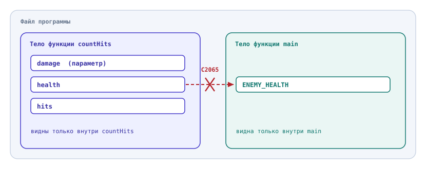
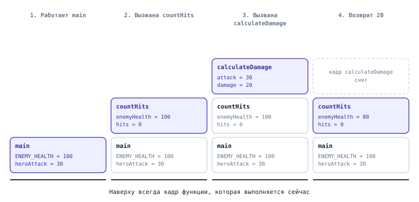
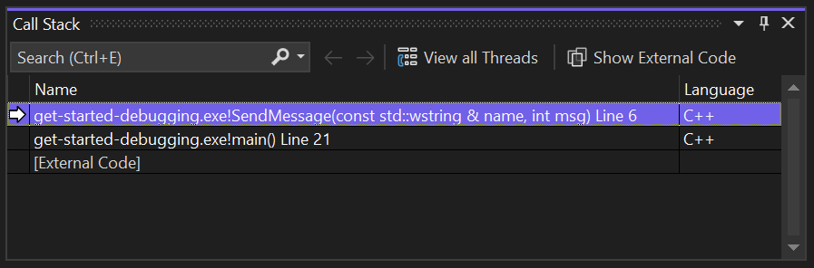

# Область видимости и стек вызовов

## Содержание

- [Область видимости и стек вызовов](#область-видимости-и-стек-вызовов)
  - [Содержание](#содержание)
  - [Вопросы для самопроверки](#вопросы-для-самопроверки)
  - [О чём мы говорили в прошлой главе?](#о-чём-мы-говорили-в-прошлой-главе)
  - [Почему функция не видит переменную из main](#почему-функция-не-видит-переменную-из-main)
  - [Область видимости](#область-видимости)
    - [Локальные переменные](#локальные-переменные)
    - [Переменная цикла for](#переменная-цикла-for)
  - [Время жизни переменной](#время-жизни-переменной)
  - [Одинаковые имена](#одинаковые-имена)
  - [Глобальные переменные](#глобальные-переменные)
  - [Стек вызовов](#стек-вызовов)
    - [Кадры стека](#кадры-стека)
    - [Окно Call Stack](#окно-call-stack)
  - [Пример. Арена: функция вызывает функцию](#пример-арена-функция-вызывает-функцию)
  - [Типичные ошибки](#типичные-ошибки)
  - [Резюме](#резюме)

## Вопросы для самопроверки

1. Почему функция не может обратиться к переменной, объявленной внутри `main`? Как передать ей это значение?

2. Скомпилируется ли этот фрагмент? Если нет, как его исправить?

   ```cpp
   if (health < 50) {
       int bonus = 20;
       health = health + bonus;
   }

   std::cout << bonus << '\n';
   ```

3. Почему после цикла `for (int enemy = 1; enemy <= 3; enemy = enemy + 1)` нельзя вывести `enemy`?

4. Функцию `spawnEnemy` вызвали три раза. Что она выведет и почему?

   ```cpp
   void spawnEnemy() {
       int spawned = 0;
       spawned = spawned + 1;
       std::cout << "Spawned: " << spawned << '\n';
   }
   ```

5. Что выведет этот фрагмент, если `countHits(100, 30)` возвращает `4`? Почему?

   ```cpp
   int totalHits = 0;

   for (int wave = 1; wave <= 3; wave = wave + 1) {
       int totalHits = countHits(100, 30);
   }

   std::cout << totalHits << '\n';
   ```

6. Чем опасна глобальная переменная, которую меняют несколько функций? Почему глобальная константа такой опасности не создаёт?

7. Что хранится в кадре стека? Какой кадр окажется наверху стека после того, как `main` вызвала `countHits`, а `countHits` вызвала `calculateDamage`?

## О чём мы говорили в прошлой главе?

В прошлой главе программа арены разделилась на функции. После этого остались два вопроса:

1. Имя `damage` объявлено в трёх функциях одной программы, и эти переменные не мешают друг другу. Почему?
2. Параметр получает копию значения, поэтому `heal(playerHealth)` не меняет здоровье игрока. Может ли функция изменить переменную вызывающего кода иначе?

Эта глава отвечает на оба вопроса.

## Почему функция не видит переменную из main

Попробуем упростить функцию подсчёта ударов: пусть она не получает здоровье врага параметром, а берёт его из константы `ENEMY_HEALTH`, объявленной в `main`.

```cpp
#include <iostream>

int countHits(int damage) {
    int health = ENEMY_HEALTH;
    int hits = 0;

    while (health > 0) {
        health = health - damage;
        hits = hits + 1;
    }

    return hits;
}

int main() {
    const int ENEMY_HEALTH = 100;

    std::cout << countHits(30) << '\n';

    return 0;
}
```

Программа не скомпилируется. Visual Studio сообщит об ошибке C2065[^1]:

```text
'ENEMY_HEALTH': undeclared identifier
```

Компилятор показывает, что имя `ENEMY_HEALTH` не объявлено, хотя оно объявлено в `main`. Порядок строк здесь ни при чём: важно, _в каком блоке_ объявлено имя. Для функции `countHits` имени из блока `main` не существует.

## Область видимости

Ошибка C2065 возникла потому, что каждое имя действует не во всей программе, а только в её части.

### Локальные переменные

**Область видимости (scope)** - часть программы, в которой имя переменной можно использовать[^2]. Компилятор ищет объявление имени только среди объявлений, которые видны в этом месте программы[^3].

**Локальная переменная (local variable)** - переменная, объявленная внутри функции или внутри блока. Она видна от строки объявления до конца своего блока[^2]. Напомним, что блок - это инструкции в фигурных скобках `{` и `}`: тело функции, тело `if` и тело цикла.

Параметры функции тоже локальные: они видны во всём теле своей функции и больше нигде[^2].



_Рисунок 8.1. Каждая функция видит только свои переменные_

На рисунке 8.1, у `countHits` и `main` свои блоки, и ни один из них не видит переменные другого. Значение из `main` попадает в функцию только через аргумент. Чтобы исправить программу, здоровье врага делают параметром:

- заголовок функции становится `int countHits(int health, int damage)`,
- строка `int health = ENEMY_HEALTH;` удаляется,
- вызов в `main` становится `countHits(ENEMY_HEALTH, 30)`.

Теперь программа соберётся и выведет `4`.

То же правило действует и для блоков внутри одной функции. Вложенный блок видит переменные внешнего блока, а внешний блок не видит переменные вложенного.

Рассмотрим пример. Пусть этот фрагмент находится в `main`:

```cpp
int health = 30;

if (health < 50) {
    int bonus = 20;
    health = health + bonus;
}

std::cout << health << '\n';
std::cout << bonus << '\n';
```

- Строка с `health` ошибки не вызывает: переменная объявлена в блоке `main`, поэтому видна и внутри `if`, и после него.
- На строке с `bonus` компилятор снова выдаст C2065: переменная объявлена в блоке `if` и за его концом не видна.

Если значение нужно после блока, переменную объявляют _до_ блока. Строку `int bonus = 0;` ставят перед `if`, а внутри блока только присваивают `bonus = 20;`. Тогда фрагмент выведет `50` и `20`.

### Переменная цикла for

Переменная, объявленная в заголовке `for`, видна только внутри цикла[^2]:

```cpp
for (int enemy = 1; enemy <= 3; enemy = enemy + 1) {
    std::cout << "Enemy " << enemy << " spawned\n";
}

std::cout << enemy << '\n';
```

На последней строке Visual Studio выдаст ошибку C2065: после закрывающей скобки цикла область видимости переменной `enemy` закончилась, и такого имени больше нет.

Такое ограничение полезно. C++ Core Guidelines советуют делать области видимости как можно меньше: так код легче читать и сложнее случайно использовать значение не там, где нужно[^4].

Рассмотрим пример. В каждой из трёх волн должны появиться два врага:

```cpp
int enemy = 1;

for (int wave = 1; wave <= 3; wave = wave + 1) {
    while (enemy <= 2) {
        std::cout << "Wave " << wave << ", enemy " << enemy << '\n';
        enemy = enemy + 1;
    }
}
```

Программа выведет только две строки, обе для первой волны. Счётчик `enemy` объявлен перед внешним циклом, поэтому после первой волны он остаётся равным `3`, и во второй и третьей волне условие `enemy <= 2` сразу ложно. Если перенести объявление `int enemy = 1;` в начало тела `for`, счётчик будет создаваться заново в начале каждой волны, и программа выведет все шесть строк.

_Объявляйте переменную в самом маленьком блоке, где она нужна._

## Время жизни переменной

Область видимости отвечает на вопрос "_где имя можно использовать_". Есть и второй вопрос: _когда переменная существует_.

**Время жизни (lifetime)** - промежуток выполнения программы, в течение которого переменная существует и хранит значение. Локальная переменная создаётся, когда выполнение доходит до её объявления, и уничтожается, когда выполнение покидает её блок[^5][^2].

Рассмотрим пример. Функция должна считать, сколько врагов появилось на арене:

```cpp
#include <iostream>

void spawnEnemy() {
    int spawned = 0;
    spawned = spawned + 1;
    std::cout << "Spawned: " << spawned << '\n';
}

int main() {
    spawnEnemy();
    spawnEnemy();
    spawnEnemy();

    return 0;
}
```

Программа выведет:

```text
Spawned: 1
Spawned: 1
Spawned: 1
```

При каждом вызове `spawnEnemy` создаётся новая переменная `spawned` со значением `0`, увеличивается до `1` и уничтожается при выходе из функции. Следующий вызов ничего не знает о предыдущем.

Чтобы счёт сохранялся, переменная должна жить в `main`: эта функция работает дольше, чем все вызовы `spawnEnemy`. Функция `spawnEnemy` получает текущее значение и возвращает новое:

```cpp
int spawnEnemy(int spawned) {
    spawned = spawned + 1;
    std::cout << "Spawned: " << spawned << '\n';

    return spawned;
}

int main() {
    int spawned = 0;

    spawned = spawnEnemy(spawned);
    spawned = spawnEnemy(spawned);
    spawned = spawnEnemy(spawned);

    return 0;
}
```

Теперь программа выведет `Spawned: 1`, `Spawned: 2` и `Spawned: 3`. Здесь две разные переменные `spawned`: одна живёт в `main` всё время работы программы, другая, параметр, создаётся при каждом вызове и получает копию значения.

## Одинаковые имена

Теперь можно ответить на первый вопрос из [раздела "О чём мы говорили в прошлой главе?"](#о-чём-мы-говорили-в-прошлой-главе): почему три переменные `damage` не мешают друг другу. Каждая объявлена в своей функции и имеет свою область видимости, поэтому это три разные переменные. Одинаковые имена в разных функциях компилятор допускает[^2].

Опасность появляется, когда одно имя объявлено во вложенном блоке, а снаружи уже есть переменная с таким же именем.

**Сокрытие имени (shadowing)** - ситуация, когда переменная во вложенном блоке имеет то же имя, что и переменная снаружи, и внутри блока скрывает её[^2][^4].

Рассмотрим пример. Программа должна сложить удары трёх волн:

```cpp
int totalHits = 0;

for (int wave = 1; wave <= 3; wave = wave + 1) {
    int totalHits = countHits(100, 30);
}

std::cout << "Total hits: " << totalHits << '\n';
```

Программа выведет `Total hits: 0`. Внутри цикла объявление `int totalHits` создало новую переменную, которая скрыла внешнюю. Все результаты записывались в неё и пропадали в конце каждой итерации, а внешняя `totalHits` осталась равной нулю.

Чтобы исправить ошибку, уберите `int` и накапливайте результат во внешней переменной: `totalHits = totalHits + countHits(100, 30);`. Тогда программа выведет `Total hits: 12`. C++ Core Guidelines называют повторное использование имён во вложенных блоках известным источником ошибок[^4]. Если в свойствах проекта уровень предупреждений (Warning Level) поднят до 4, Visual Studio предупредит о сокрытии имени сообщением C4456 "declaration of 'totalHits' hides previous local declaration"[^6].

## Глобальные переменные

До сих пор каждая переменная принадлежала какой-то функции. Переменную можно объявить и вне всех функций.

**Глобальная переменная (global variable)** - переменная, объявленная вне всех функций. Она видна от места объявления до конца файла, в том числе внутри любой функции, которая записана ниже по файлу[^2]. Глобальная переменная существует всё время работы программы[^5].

Рассмотрим пример. Функция лечения меняет глобальное здоровье игрока:

```cpp
#include <iostream>

int playerHealth = 50;

void heal() {
    playerHealth = playerHealth + 20;
}

int main() {
    heal();

    std::cout << playerHealth << '\n';

    return 0;
}
```

Программа выведет `70`. Функция может изменить переменную, если эта переменная глобальная. В C++ есть и другие способы.

Мы этим способом пользоваться не будем и обходимся возвратом значения. C++ Core Guidelines советуют избегать изменяемых глобальных переменных, потому что они скрывают зависимости между частями программы[^4]. По строке `heal();` в `main` не видно, что функция меняет `playerHealth`. Если глобальное здоровье меняют двадцать функций, при ошибке придётся проверять все двадцать. Если же функция возвращает новое здоровье, по строке `playerHealth = heal(playerHealth);` сразу видно, какая переменная меняется и где.

> [!TIP]
>
> _Глобальная константа допустима_. Константу `const int MAX_HEALTH = 100;` изменить нельзя, поэтому опасности скрытых изменений нет[^4]. Такую константу можно объявить перед всеми функциями и использовать в любой из них.

## Стек вызовов

### Кадры стека

До сих пор функции вызывала только `main`. Но функция может вызвать и другую функцию. Пусть `countHits` для каждого удара вызывает `calculateDamage`. Герой с атакой `30` бьёт врага со здоровьем `100` и защитой `10`:

```cpp
#include <iostream>

int calculateDamage(int attack, int defense) {
    int damage = attack - defense;

    if (damage < 1) {
        damage = 1;
    }

    return damage;
}

int countHits(int enemyHealth, int attack, int defense) {
    int hits = 0;

    while (enemyHealth > 0) {
        enemyHealth = enemyHealth - calculateDamage(attack, defense);
        hits = hits + 1;
    }

    return hits;
}

int main() {
    const int ENEMY_HEALTH = 100;
    int heroAttack = 30;
    int enemyDefense = 10;

    int hits = countHits(ENEMY_HEALTH, heroAttack, enemyDefense);

    std::cout << "Hits: " << hits << '\n';

    return 0;
}
```

Программа выведет `Hits: 5`: каждый удар наносит `30 - 10 = 20` единиц урона, и здоровье врага меняется так: `80`, `60`, `40`, `20`, `0`.

Пока выполняется `calculateDamage`, функции `countHits` и `main` не закончены: они ждут результата. У каждой из трёх функций свои переменные, и программа должна помнить, куда вернуться из каждой.

**Стек вызовов (call stack)** - область памяти, где программа хранит сведения о функциях, которые вызваны, но ещё не завершились[^7].

**Кадр стека (stack frame)** - часть стека вызовов, которая относится к одному вызову функции. В кадре хранятся[^7]:

- параметры,
- локальные переменные,
- место, куда нужно вернуться после завершения функции.



_Рисунок 8.2. Стек вызовов растёт при вызове и уменьшается при возврате_

На рисунке 8.2 видно, что наверху всегда кадр той функции, которая выполняется сейчас. Когда `calculateDamage` вернёт урон, её кадр вместе с переменной `damage` исчезнет, и выполнение продолжится в `countHits`. Кадры `main` и `countHits` остаются в стеке: их переменные существуют, но `calculateDamage` их не видит. Здесь видна разница между временем жизни переменной и её областью видимости: время жизни определяет, как долго существует переменная, а область видимости — где в коде её можно использовать.

### Окно Call Stack

Стек вызовов можно увидеть в Visual Studio. _Call Stack_ - окно отладчика, которое показывает, в каком порядке были вызваны функции[^9]. Как и окно Locals, оно доступно только во время отладки. Если его не видно, нажмите Ctrl+Alt+C[^9].



_Рисунок 8.3. Окно Call Stack. Источник: Microsoft, CC BY 4.0[^10]_

На рисунке 8.3 показан снимок из документации Microsoft. Верхняя строка со стрелкой - функция, которая выполняется сейчас (`SendMessage`), строка под ней - функция, которая её вызвала (`main`)[^10]. Строку `[External Code]` можно не замечать: этот код мы не писали, он только запускает `main`.

Двойной щелчок по строке окна показывает переменные этого кадра в окне Locals. Выполнение при этом остаётся на прежнем месте[^9].

## Пример. Арена: функция вызывает функцию

Запустим программу из раздела "Кадры стека" под отладчиком. Она есть в папке [code](code/) в файле `14_arena_call_stack.cpp`.

1. Поставьте точку останова на строку `return damage;` в функции `calculateDamage` и запустите отладку клавишей F5.
2. Откройте окно Call Stack. В нём сверху вниз расположены `calculateDamage`, `countHits` и `main`. Под `main` может быть строка `[External Code]`.
3. В окне Locals видны `attack`, `defense` и `damage` со значением `20`, то есть только переменные верхнего кадра.
4. Дважды щёлкните по строке `countHits`. Теперь Locals показывает `enemyHealth` со значением `100`, `hits` со значением `0`, а также `attack` и `defense`.

Переменные `attack` и `defense` есть и в кадре `calculateDamage`, и в кадре `countHits`. Это разные переменные с одинаковыми именами, как в [разделе "Одинаковые имена"](#одинаковые-имена): у каждого вызова свой кадр со своими переменными.

## Типичные ошибки

- _Функция обращается к переменной из `main`_. Нужное значение передают в функцию аргументом.
- _Переменная нужна после блока, но объявлена внутри него_. Объявите её перед блоком.
- _Счётчик цикла используют после `for`_. Если значение нужно после цикла, сохраните его в переменную, объявленную до цикла.
- _Ожидают, что локальная переменная сохранит значение до следующего вызова_. Она создаётся заново при каждом вызове.
- _Лишнее `int` внутри блока_. Новая переменная скрывает внешнюю с тем же именем, и результат теряется.
- _Функцию заставляют менять глобальную переменную_. Возвращайте результат и записывайте его в переменную вызывающего кода.

## Резюме

1. Область видимости - часть программы, где имя можно использовать; локальная переменная видна от объявления до конца своего блока.
2. Функция видит только свои параметры и локальные переменные; данные из вызывающего кода она получает через аргументы.
3. Переменная из заголовка `for` существует только внутри цикла; переменные стоит объявлять в самом маленьком подходящем блоке.
4. Локальная переменная создаётся при объявлении и уничтожается при выходе из блока, поэтому при каждом вызове функции она новая.
5. Одинаковые имена в разных функциях не мешают, а во вложенных блоках скрывают внешнюю переменную.
6. Глобальная переменная видна всем функциям ниже по файлу; изменяемые глобальные переменные скрывают зависимости, глобальные константы допустимы.
7. Стек вызовов хранит кадры незавершённых вызовов: кадр кладётся при вызове и снимается при возврате.
8. Окно Call Stack в Visual Studio показывает цепочку вызовов, а двойной щелчок по кадру показывает его переменные в Locals.

[^1]: Microsoft (2022). _Compiler Error C2065_. Microsoft Learn. Available at: https://learn.microsoft.com/en-us/cpp/error-messages/compiler-errors-1/compiler-error-c2065

[^2]: Microsoft (2018). _Scope (C++)_. Microsoft Learn. Available at: https://learn.microsoft.com/en-us/cpp/cpp/scope-visual-cpp

[^3]: cppreference.com (n.d.). _Scope_. Available at: https://en.cppreference.com/w/cpp/language/scope

[^4]: Stroustrup, B. and Sutter, H. (eds.) (n.d.). _C++ Core Guidelines_. ES.5, ES.12, I.2. Available at: https://isocpp.github.io/CppCoreGuidelines/CppCoreGuidelines

[^5]: cppreference.com (n.d.). _Storage class specifiers and storage duration_. Available at: https://en.cppreference.com/w/cpp/language/storage_duration

[^6]: Microsoft (2016). _Compiler Warning (level 4) C4456_. Microsoft Learn. Available at: https://learn.microsoft.com/en-us/cpp/error-messages/compiler-warnings/compiler-warning-level-4-c4456

[^7]: Wikipedia (n.d.). _Call stack_. Available at: https://en.wikipedia.org/wiki/Call_stack

[^8]: Wikipedia (n.d.). _Stack (abstract data type)_. Available at: https://en.wikipedia.org/wiki/Stack_(abstract_data_type)

[^9]: Microsoft (2026). _View the call stack and use the Call Stack window in the debugger_. Microsoft Learn. Available at: https://learn.microsoft.com/en-us/visualstudio/debugger/how-to-use-the-call-stack-window

[^10]: Microsoft (2025). _Tutorial: Debug C++ code with Visual Studio_. Microsoft Learn. Изображение из репозитория MicrosoftDocs/visualstudio-docs, лицензия CC BY 4.0. Available at: https://learn.microsoft.com/en-us/visualstudio/debugger/getting-started-with-the-debugger-cpp
