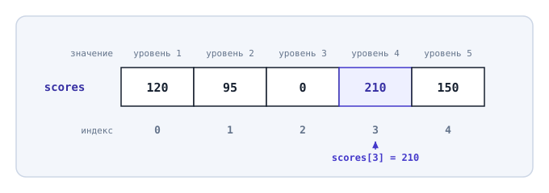
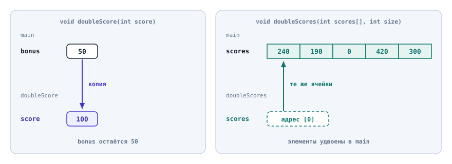
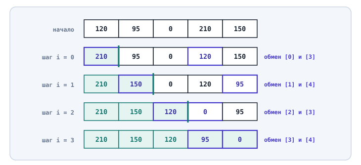
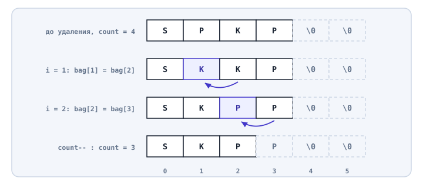

# Структуры данных. Массивы

## Содержание

- [Структуры данных. Массивы](#структуры-данных-массивы)
  - [Содержание](#содержание)
  - [Вопросы для самопроверки](#вопросы-для-самопроверки)
  - [Ретроспектива](#ретроспектива)
  - [Структуры данных](#структуры-данных)
  - [Массив](#массив)
    - [Что такое массив](#что-такое-массив)
    - [Объявление массива](#объявление-массива)
    - [Начальные значения](#начальные-значения)
    - [Доступ к элементу по индексу](#доступ-к-элементу-по-индексу)
  - [Обход массива](#обход-массива)
    - [Вывод всех элементов](#вывод-всех-элементов)
    - [Изменение всех элементов](#изменение-всех-элементов)
    - [Сумма и подсчёт](#сумма-и-подсчёт)
    - [Наибольший элемент](#наибольший-элемент)
  - [Выход за границы массива](#выход-за-границы-массива)
  - [Массивы и функции](#массивы-и-функции)
    - [Массив как параметр](#массив-как-параметр)
    - [Функция меняет исходный массив](#функция-меняет-исходный-массив)
    - [Массив в отладчике](#массив-в-отладчике)
  - [Поиск в массиве](#поиск-в-массиве)
  - [Сортировка массива](#сортировка-массива)
    - [Пузырьковая сортировка](#пузырьковая-сортировка)
    - [Сортировка выбором](#сортировка-выбором)
    - [Сколько работы делает сортировка](#сколько-работы-делает-сортировка)
  - [Вместимость и количество элементов](#вместимость-и-количество-элементов)
    - [Удаление элемента](#удаление-элемента)
    - [Добавление элемента](#добавление-элемента)
    - [Вставка элемента](#вставка-элемента)
  - [Когда массив подходит](#когда-массив-подходит)
  - [Пример. Экран результатов](#пример-экран-результатов)
  - [Типичные ошибки](#типичные-ошибки)
  - [Резюме](#резюме)

## Вопросы для самопроверки

1. Какую задачу решает массив по сравнению с пятью отдельными переменными?
2. Массив объявлен как `int scores[5]`. Какой индекс у первого и у последнего элемента?
3. Какие значения получат элементы массива `int scores[5] = {120, 95};`?
4. Почему цикл `for (int i = 0; i <= 5; i++)` по массиву из пяти элементов содержит ошибку, хотя программа может работать без видимых сбоев?
5. Зачем функции, которая получает массив, нужен отдельный параметр с размером?
6. Функция с параметром `int score` не меняет переменную в `main`, а функция с параметром `int scores[]` меняет элементы массива. Почему?
7. Что возвращает функция линейного поиска, если элемент не найден, и почему это значение не может быть индексом?
8. Как работают пузырьковая сортировка и сортировка выбором? Сколько сравнений сделает каждая из них для массива из пяти элементов?
9. Чем вместимость массива отличается от количества элементов, которые в нём сейчас хранятся?

## Ретроспектива

В прошлых главах программа арены была разделена на функции. Функция получала значения через параметры, возвращала результат через `return`, а каждая переменная жила в своей области видимости. Но все значения хранились в отдельных переменных:

- здоровье героя,
- урон,
- количество ударов.

Настоящие игры хранят не одно значение, а много однотипных:

- очки за каждый уровень,
- здоровье каждого врага,
- предметы в рюкзаке.

Эта глава отвечает на вопрос, как хранить такие значения вместе и обрабатывать их циклом.

## Структуры данных

Пока данных мало, для каждого значения хватает своей переменной. Когда однотипных значений пять, десять или сто, отдельные переменные перестают работать:

- нельзя одним циклом пройти по переменным `score1`, `score2`, `score3`,
- нельзя выбрать переменную по номеру, который ввёл пользователь, без длинной цепочки `if`,
- добавление шестого значения требует правки каждого места, где перечислены первые пять.

**Структура данных (data structure)** - способ организовать данные в памяти так, чтобы с ними было удобно и быстро выполнять нужные операции[^1]. У каждой структуры данных две стороны:

- _Как данные хранятся_. Например, значения лежат подряд и пронумерованы.
- _Какие операции удобны_. Например, получить значение по номеру, перебрать все значения, найти нужное.

Рассмотрим пример из жизни. Список покупок на листке и тетрадь с пронумерованными страницами хранят одну и ту же информацию по-разному. В списке легко дописать строку в конец. В тетради легко открыть страницу номер 12. Выбор зависит от того, что с данными придётся делать чаще.

В этой и двух следующих главах разбираются три простые структуры данных:

| Структура            | Что хранит                               | Пример из игры                       | Глава        |
| -------------------- | ---------------------------------------- | ------------------------------------ | ------------ |
| Массив               | Много значений одного типа               | Очки за пять уровней                 | Эта          |
| Двумерный массив     | Таблицу значений одного типа             | Карта уровня из клеток               | Десятая      |
| Структура (`struct`) | Несколько разных свойств одного предмета | Название, цена и количество предмета | Одиннадцатая |

Массив - самая простая из них, а двумерный массив строится на его основе.

## Массив

### Что такое массив

**Массив (array)** - набор из фиксированного числа значений _одного типа_, которые хранятся в памяти подряд и доступны по одному общему имени[^2][^3].

При работе с массивом есть несколько ключевых понятий:

- **Элемент массива (element)** - одно значение внутри массива.
- **Индекс (index)** - номер элемента в массиве. В C++ индексы начинаются с нуля: у массива из `N` элементов индексы идут от `0` до `N - 1`[^2].
- _Размер массива_ - количество элементов, которое задаётся при объявлении и потом не меняется.

Индекс показывает, на сколько элементов элемент отстоит от начала массива. Первый элемент отстоит на ноль элементов, поэтому его индекс `0`.

Массив нужен, когда значений много, у них один тип и один смысл, и их нужно обрабатывать циклом или выбирать по номеру. Верный признак: имена переменных отличаются только цифрой, как `score1`, `score2`, `score3`.

Рассмотрим пример. Мобильная игра из пяти уровней хранит лучший результат игрока на каждом уровне. Ноль означает, что уровень ещё не пройден.



_Рисунок 9.1. Массив scores: пять элементов подряд, индексы от 0 до 4_

На рисунке 9.1 массив `scores` занимает пять соседних ячеек памяти. Над ячейками записаны значения, под ними - индексы. Очки первого уровня лежат в элементе с индексом `0`, очки пятого - в элементе с индексом `4`. Номер уровня, который видит игрок, на единицу больше индекса.

### Объявление массива

Массив объявляется как переменная, но после имени в квадратных скобках указывается размер:

```cpp
const int LEVELS = 5;
int scores[LEVELS];
```

Запись `int scores[LEVELS]` читается так: "массив `scores` из `LEVELS` элементов типа `int`". Тип относится к каждому элементу: все пять элементов будут целыми числами. Если записать в массив `int` символ, в элементе хранится код этого символа из третьей главы.

Размер должен быть известен компилятору ещё до запуска программы. Подходит целый литерал (`int scores[5]`) или именованная константа, значение которой задано литералом (`int scores[LEVELS]`)[^3]. Константа удобнее: если уровней станет семь, исправить придётся одну строку, а все циклы, которые используют `LEVELS`, изменятся сами.

> [!WARNING]
>
> Размер встроенного массива нельзя ввести с клавиатуры. Запись `int n; std::cin >> n; int scores[n];` не входит в стандарт C++. Visual Studio такую программу не скомпилирует[^3], а некоторые другие компиляторы принимают её как свою дополнительную возможность, которой нет в стандарте[^4]. Если количество значений заранее неизвестно, объявите массив с запасом и храните, сколько элементов занято.
>
> Динамические массивы, размер которых можно задать во время выполнения, будут рассмотрены в соответствующем курсе.

### Начальные значения

Как и обычная локальная переменная из шестой главы, локальный массив без начальных значений содержит неопределённые значения (мусор): в каждом элементе лежит то, что оказалось в этой памяти раньше[^3][^5]. Чтение такого элемента - неопределённое поведение.

**Инициализация массива** - задание начальных значений элементов при объявлении. Значения перечисляются в фигурных скобках через запятую по порядку индексов[^6].

Рассмотрим пример:

```cpp
const int LEVELS = 5;
int scores[LEVELS] = {120, 95, 0, 210, 150};
```

Значение `120` попадает в `scores[0]`, `95` - в `scores[1]` и так далее до `150` в `scores[4]`.

Если значений в скобках меньше, чем элементов, оставшиеся элементы получают ноль[^6]. Пустые скобки обнуляют весь массив:

```cpp
int scores[5] = {120, 95};    // 120, 95, 0, 0, 0
int stars[5] = {};            // 0, 0, 0, 0, 0
```

Программа выводит `120 95 0` для первых трёх элементов `scores` и `0 0` для первого и последнего элемента `stars`.

Если значений больше, чем элементов, программа не скомпилируется. Visual Studio сообщит об ошибке `too many initializers` (слишком много инициализаторов)[^7].

Массив может хранить не только числа. Например, рюкзак игрока можно описать массивом символов, где каждая буква обозначает предмет:

- `S` - меч (sword),
- `P` - зелье (potion),
- `K` - ключ (key).

Объявление выглядит так:

```cpp
char bag[4] = {'S', 'P', 'K', 'P'};
```

В рюкзаке четыре предмета: меч, зелье, ключ и ещё одно зелье. Этот массив понадобится в разделе "Поиск в массиве".

### Доступ к элементу по индексу

Чтобы прочитать или изменить один элемент, после имени массива в квадратных скобках пишут индекс: `scores[0]`, `scores[4]`. Элемент массива ведёт себя как обычная переменная: его можно вывести, использовать в выражении и изменить присваиванием.

Рассмотрим пример:

```cpp
#include <iostream>

int main() {
    const int LEVELS = 5;
    int scores[LEVELS] = {120, 95, 0, 210, 150};

    std::cout << "Level 1: " << scores[0] << '\n';
    std::cout << "Level 5: " << scores[4] << '\n';

    scores[2] = 80;
    std::cout << "Level 3: " << scores[2] << '\n';

    return 0;
}
```

Результат:

```text
Level 1: 120
Level 5: 150
Level 3: 80
```

Первый уровень хранится в `scores[0]`, и программа выводит `120`. Пятый уровень хранится в `scores[4]`, и программа выводит `150`. Строка `scores[2] = 80;` записывает новый результат третьего уровня: игрок прошёл его на `80` очков. Остальные элементы не изменились.

Индекс не обязан быть литералом. Индексом может быть переменная или выражение, и именно это делает массив удобнее отдельных переменных. Программа показывает очки уровня, номер которого ввёл игрок:

```cpp
int level = 0;
std::cout << "Level number: ";
std::cin >> level;

std::cout << "Score: " << scores[level - 1] << '\n';
```

Если ввести `4`, выражение `level - 1` даёт `3`, и программа выводит `Score: 210`. С отдельными переменными для этого понадобились бы пять ветвей `if`, а здесь хватает одной строки.

Здесь часто делают две ошибки:

- _Номер путают с индексом_. Четвёртый уровень хранится в `scores[3]`, а не в `scores[4]`. Номер переводят в индекс в одном месте программы, вычитая единицу.
- _Размер путают с последним индексом_. У массива `int scores[5]` нет элемента `scores[5]`: последний элемент - `scores[4]`.

## Обход массива

Почти любая работа с массивом сводится к одному действию над каждым элементом:

- вывести,
- изменить,
- сложить,
- сравнить.

Писать отдельную строку для каждого индекса неудобно, а при размере в сто элементов невозможно.

**Обход массива (traversal)** - последовательная обработка всех элементов массива по очереди, от первого до последнего. Обычно обход записывают циклом `for`, в котором переменная `i` пробегает все индексы от `0` до размера минус один:

```cpp
for (int i = 0; i < LEVELS; i++) {
    // действие с элементом scores[i]
}
```

Запись `i++` из четвёртой главы увеличивает `i` на единицу после каждой итерации. Условие `i < LEVELS` останавливает цикл, когда `i` становится равным `5`: элемента с таким индексом нет. Внутри тела цикла `scores[i]` на каждой итерации обозначает следующий элемент.

### Вывод всех элементов

Самый простой обход выводит все элементы. Рассмотрим пример [`04_print_all.cpp`](code/04_print_all.cpp):

```cpp
for (int i = 0; i < LEVELS; i++) {
    std::cout << "Level " << i + 1 << ": " << scores[i] << '\n';
}
```

Результат:

```text
Level 1: 120
Level 2: 95
Level 3: 0
Level 4: 210
Level 5: 150
```

Для игрока программа выводит номер уровня `i + 1`, а значение берёт по индексу `i`.

Таблица трассировки показывает все итерации:

| `i` | `i < LEVELS` | `scores[i]` | Что выведено   |
| --: | ------------ | ----------: | -------------- |
|   0 | истина       |         120 | `Level 1: 120` |
|   1 | истина       |          95 | `Level 2: 95`  |
|   2 | истина       |           0 | `Level 3: 0`   |
|   3 | истина       |         210 | `Level 4: 210` |
|   4 | истина       |         150 | `Level 5: 150` |
|   5 | ложь         |           - | цикл завершён  |

Последняя строка таблицы важна: при `i = 5` условие ложно, и к `scores[5]` программа не обращается.

### Изменение всех элементов

Обход может не только читать элементы, но и менять их. Рассмотрим пример: в выходные в игре проходит событие, и все результаты удваиваются:

```cpp
for (int i = 0; i < LEVELS; i++) {
    scores[i] = scores[i] * 2;
}
```

После цикла массив содержит `240 190 0 420 300`. Каждый элемент умножен на два, а непройденный третий уровень остался нулём, потому что `0 * 2 = 0`.

Так же обход заполняет массив с клавиатуры. Программа [`06_read_scores.cpp`](code/06_read_scores.cpp) просит ввести очки каждого уровня и записывает их в элементы по очереди:

```cpp
for (int i = 0; i < LEVELS; i++) {
    std::cout << "Level " << i + 1 << " score: ";
    std::cin >> scores[i];
}
```

На первой итерации введённое число попадает в `scores[0]`, на второй - в `scores[1]`, и так до `scores[4]`.

### Сумма и подсчёт

Две частые задачи - посчитать сумму элементов и посчитать, сколько элементов подходит под условие. Обе решаются одним приёмом.

_Накопитель (accumulator)_ - переменная, которая объявляется до цикла со значением `0` и на каждой итерации получает добавку: значение элемента или единицу. Счётчик из пятой главы - частный случай накопителя.

Рассмотрим пример. Программа считает общий счёт игрока и количество пройденных уровней:

```cpp
int total = 0;
int passed = 0;

for (int i = 0; i < LEVELS; i++) {
    total = total + scores[i];

    if (scores[i] > 0) {
        passed++;
    }
}

std::cout << "Total: " << total << '\n';
std::cout << "Passed: " << passed << " of " << LEVELS << '\n';
```

Результат:

```text
Total: 575
Passed: 4 of 5
```

Сумма получается так: `120 + 95 + 0 + 210 + 150 = 575`. Счётчик `passed` увеличивается только тогда, когда `scores[i] > 0`. Ноль стоит у одного уровня, поэтому пройдено `4` уровня из `5`.

Накопитель объявляют до цикла. Если перенести `int total = 0;` внутрь цикла, строка вывода после цикла не скомпилируется: имя `total` там недоступно. Если же внешняя `total` останется, а внутри цикла появится вторая `int total`, она скроет внешнюю, и сумма не накопится. Оба случая разобраны в прошлой главе, в разделах об области видимости и о сокрытии имён.

### Наибольший элемент

Часто нужно найти в массиве наибольший или наименьший элемент. В игре это самый сильный враг, самый дорогой предмет или лучший уровень.

_Поиск наибольшего элемента_ - обход, при котором программа запоминает индекс лучшего на данный момент элемента и сравнивает с ним каждый следующий.

Рассмотрим пример:

```cpp
int best = 0;

for (int i = 1; i < LEVELS; i++) {
    if (scores[i] > scores[best]) {
        best = i;
    }
}

std::cout << "Best level: " << best + 1 << '\n';
std::cout << "Score: " << scores[best] << '\n';
```

Результат:

```text
Best level: 4
Score: 210
```

Программа сначала считает лучшим первый элемент (`best = 0`), поэтому цикл начинается с `i = 1`. Дальше каждый элемент сравнивается с текущим лучшим:

| `i` | `scores[i]` | `scores[best]` до сравнения | `best` после сравнения |
| --: | ----------: | --------------------------: | ---------------------: |
|   1 |          95 |                         120 |                      0 |
|   2 |           0 |                         120 |                      0 |
|   3 |         210 |                         120 |                      3 |
|   4 |         150 |                         210 |                      3 |

Переменная `best` хранит индекс, а не значение. По индексу можно узнать и номер уровня (`best + 1 = 4`), и сами очки (`scores[best] = 210`). Если бы программа хранила только значение `210`, номер уровня был бы потерян.

Начальным кандидатом лучше брать первый элемент. Вариант "лучшее значение равно нулю" работает для очков, но ломается, если все значения отрицательные или если искать наименьший элемент. Первый элемент подходит для любого непустого массива.

## Выход за границы массива

Цикл обхода легко написать с ошибкой на единицу. Компилятор такую ошибку обычно не замечает, потому что индекс становится известен только во время работы программы.

**Выход за границы массива (out-of-bounds access)** - обращение к элементу с индексом меньше `0` или больше `N - 1`, где `N` - размер массива. В C++ это неопределённое поведение: язык не проверяет индекс, а следить за ним должен программист[^3][^8].

Рассмотрим пример. Эта программа содержит ошибку:

```cpp
for (int i = 0; i <= LEVELS; i++) {
    std::cout << "Level " << i + 1 << ": " << scores[i] << '\n';
}
```

Условие `i <= LEVELS` пропускает в тело цикла значение `i = 5`. Программа выводит пять правильных строк и шестую строку с числом, которого в массиве нет. Конец вывода в одном из запусков:

```text
Level 5: 150
Level 6: 2
```

Число `2` - содержимое соседней памяти, и при другом запуске или на другом компьютере оно может быть другим. Чтение за границей может также аварийно завершить программу, а запись туда может незаметно испортить соседнюю переменную.

Исправление - строгое сравнение `i < LEVELS`, как в [разделе "Обход массива"](#обход-массива). Удобно запомнить правило: _в цикле по массиву стоит `<` и размер массива_.

Вторая частая причина выхода за границы - индекс от пользователя. В программе с выбором уровня ввод `7` даёт индекс `6`, а ввод `0` - индекс `-1`. Индекс нужно проверить до обращения к массиву, как ввод в шестой главе.

```cpp
if (level >= 1 && level <= LEVELS) {
    std::cout << "Score: " << scores[level - 1] << '\n';
} else {
    std::cout << "No such level\n";
}
```

При вводе `4` программа выводит `Score: 210`, при вводе `7` - `No such level`, и к памяти за массивом она не обращается.

## Массивы и функции

Программа с несколькими обходами быстро разрастается. Как и в седьмой главе, каждое действие стоит вынести в функцию с понятным именем: `printScores`, `totalScore`.

### Массив как параметр

Параметр-массив записывается как тип, имя и пустые квадратные скобки: `int scores[]`. Размер в скобках не указывается, потому что функция его не получает: она получает только адрес первого элемента (раздел "Функция меняет исходный массив"). Внутри функции нельзя узнать, сколько элементов у переданного массива, поэтому размер передают отдельным параметром[^3].

Рассмотрим пример:

```cpp
#include <iostream>

void printScores(int scores[], int size) {
    for (int i = 0; i < size; i++) {
        std::cout << "Level " << i + 1 << ": " << scores[i] << '\n';
    }
}

int totalScore(int scores[], int size) {
    int total = 0;

    for (int i = 0; i < size; i++) {
        total = total + scores[i];
    }

    return total;
}

int main() {
    const int LEVELS = 5;
    int scores[LEVELS] = {120, 95, 0, 210, 150};

    printScores(scores, LEVELS);
    std::cout << "Total: " << totalScore(scores, LEVELS) << '\n';

    return 0;
}
```

Программа выводит пять строк с уровнями, как в [разделе "Вывод всех элементов"](#вывод-всех-элементов), и строку `Total: 575`.

Разберём вызов `printScores(scores, LEVELS)`:

1. Первый аргумент - имя массива без квадратных скобок. Запись `scores[]` или `scores[5]` в вызове будет ошибкой.
2. Второй аргумент - размер. Внутри функции он называется `size`, и цикл идёт до `size`, а не до `LEVELS`.
3. Функция не знает, что уровней пять. Её можно вызвать и для массива из десяти элементов, если передать `10`.

Функция не может вернуть массив через `return`[^9]. Результат обхода возвращают одним значением, как `totalScore`, или записывают прямо в элементы переданного массива.

### Функция меняет исходный массив

В седьмой главе параметр `int health` получал копию значения, и изменения внутри функции не влияли на переменную снаружи. С массивом всё иначе. При вызове функция получает не копию всех элементов, а _адрес_ массива: номер места в памяти, где лежит его первый элемент[^3][^9]. Функция работает с теми же ячейками памяти, что и `main`.

Рассмотрим пример:

```cpp
#include <iostream>

void doubleScore(int score) {
    score = score * 2;
}

void doubleScores(int scores[], int size) {
    for (int i = 0; i < size; i++) {
        scores[i] = scores[i] * 2;
    }
}

int main() {
    const int LEVELS = 5;
    int scores[LEVELS] = {120, 95, 0, 210, 150};
    int bonus = 50;

    doubleScore(bonus);
    doubleScores(scores, LEVELS);

    std::cout << "Bonus: " << bonus << '\n';
    std::cout << "Level 1: " << scores[0] << '\n';

    return 0;
}
```

Результат:

```text
Bonus: 50
Level 1: 240
```

Функция `doubleScore`:

- Удвоила свою копию, и переменная `bonus` в `main` осталась равной `50`.
- Удвоила элементы того самого массива, который создан в `main`, поэтому `scores[0]` стал `240`.



_Рисунок 9.2. Параметр int получает копию, параметр-массив работает с исходными элементами_

На рисунке 9.2 слева значение `50` копируется в параметр `score`, и функция меняет только копию. Справа параметр `scores` указывает на те же пять ячеек, что и массив в `main`.

Из этого следуют два правила:

- _Возвращать изменённый массив не нужно_. Изменения элементов видны в вызывающем коде сразу.
- _Функция может случайно испортить данные_. Если функция только читает массив, а по ошибке присваивает элементу значение, исходный массив изменится.

> [!IMPORTANT]
> Обычные переменные по-прежнему передаются копией. Если функция меняет и массив, и число, например количество монет, элементы массива она меняет напрямую. Новое число она возвращает через `return`, а вызывающий код сохраняет его, как в седьмой главе.

### Массив в отладчике

Содержимое массива удобно проверять в отладчике Visual Studio. Окно _Locals_ (`Debug > Windows > Locals`, `Alt+4`) показывает массив `scores` одной строкой. Стрелка слева от имени раскрывает его, и под ним появляются элементы `[0]`, `[1]` и далее с их значениями[^10]. Значение, которое изменилось после последнего шага, выделяется красным.

Внутри функции параметр `int scores[]` отладчик показывает как адрес и одно значение первого элемента: функция не знает размер, и отладчик тоже. Чтобы увидеть все элементы, откройте окно _Watch_ и введите выражение `scores,5`, где после запятой указано количество элементов[^11].

## Поиск в массиве

Частая задача - узнать, есть ли в массиве нужное значение и где оно стоит. В игре так проверяют, есть ли в рюкзаке ключ, а магазин ищет предмет по коду.

**Линейный поиск (linear search)** - поиск, при котором элементы проверяются по очереди, от первого до последнего, пока не найден нужный или пока массив не закончился[^12]. Функция поиска обычно возвращает индекс найденного элемента или `-1`, если элемента нет. Значение `-1` выбрано потому, что такого индекса не бывает.

Рассмотрим пример: в рюкзаке `{'S', 'P', 'K', 'P'}` нужно найти ключ `'K'`.

```cpp
int findItem(char bag[], int count, char item) {
    for (int i = 0; i < count; i++) {
        if (bag[i] == item) {
            return i;
        }
    }

    return -1;
}
```

Вызов `findItem(bag, 4, 'K')` возвращает `2`:

| `i` | `bag[i]` | `bag[i] == 'K'` | Что происходит                |
| --: | -------- | --------------- | ----------------------------- |
|   0 | `'S'`    | ложь            | цикл продолжается             |
|   1 | `'P'`    | ложь            | цикл продолжается             |
|   2 | `'K'`    | истина          | `return 2`, функция завершена |

Как только ключ найден, `return` завершает функцию, и последний элемент программа уже не проверяет. Вызов `findItem(bag, 4, 'G')` проверит все четыре элемента, не найдёт драгоценный камень `'G'` (gem) и дойдёт до `return -1` после цикла. Если одинаковых элементов несколько, функция вернёт индекс первого: `findItem(bag, 4, 'P')` вернёт `1`, а не `3`.

Результат поиска проверяют до того, как использовать его как индекс:

```cpp
int key = findItem(bag, 4, 'K');

if (key != -1) {
    std::cout << "The door opens\n";
} else {
    std::cout << "You need a key\n";
}
```

Если сразу написать `bag[key]` без проверки, то при `key = -1` программа выйдет за границы массива.

Частая ошибка в функции поиска - ветка `else` с `return -1` внутри цикла. Эта программа содержит ошибку:

```cpp
for (int i = 0; i < count; i++) {
    if (bag[i] == item) {
        return i;
    } else {
        return -1;
    }
}
```

Для рюкзака `{'S', 'P', 'K', 'P'}` вызов `findItem(bag, 4, 'K')` возвращает `-1`. Первый элемент `'S'` не равен `'K'`, сработала ветка `else`, и функция завершилась на первой же итерации. Ответ "элемента нет" можно дать только после того, как проверены все элементы, поэтому `return -1` должен стоять после цикла, как в исправленной версии.

Похожая функция отвечает на вопрос "есть ли элемент" и возвращает `bool`: `true` внутри цикла при совпадении, `false` после цикла. Если нужно узнать, _сколько_ таких элементов, подходит шаблон подсчёта из [раздела "Сумма и подсчёт"](#сумма-и-подсчёт).

## Сортировка массива

Часто элементы массива нужно расставить по порядку: таблица рекордов показывает результаты от лучшего к худшему, магазин - товары от дешёвых к дорогим.

**Сортировка (sorting)** - перестановка элементов массива так, чтобы они шли в заданном порядке: по возрастанию или по убыванию. Алгоритмов сортировки много. Здесь разобраны два самых простых: пузырьковая сортировка и сортировка выбором.

Обе сортировки переставляют элементы парами. Чтобы выполнить _обмен (swap)_ значений двух переменных, используют третью, временную переменную:

```cpp
int temp = a;
a = b;
b = temp;
```

Без `temp` не обойтись: при `a = 3` и `b = 5` после `a = b` обе переменные равны `5`, и тройка потеряна. В массиве обмен устроен так же, только вместо `a` и `b` стоят два элемента, например `scores[j]` и `scores[j + 1]`.

### Пузырьковая сортировка

**Пузырьковая сортировка (bubble sort)** - сортировка, при которой программа проходит по массиву, сравнивает каждую пару соседних элементов и меняет их местами, если они стоят в неправильном порядке. Проходы повторяются, пока массив не станет упорядоченным[^13].

За один проход в конец массива встаёт один элемент: при сортировке по убыванию - наименьший, по возрастанию - наибольший. Он смещается к концу шаг за шагом, как пузырёк воздуха поднимается к поверхности воды, отсюда и название.

Идея пузырьковой сортировки знакома по жизни. Так выстраивают игроков по росту от самого высокого, когда можно сравнивать только стоящих рядом: проходят вдоль шеренги и меняют местами соседей, если левый ниже правого.

Рассмотрим пример. Пять игроков набрали `120`, `95`, `0`, `210` и `150` очков, и таблицу рекордов нужно упорядочить по убыванию:

```cpp
const int PLAYERS = 5;
int scores[PLAYERS] = {120, 95, 0, 210, 150};
```

Функция сортировки:

```cpp
void bubbleSortDescending(int scores[], int size) {
    for (int pass = 0; pass < size - 1; pass++) {
        for (int j = 0; j < size - 1 - pass; j++) {
            if (scores[j] < scores[j + 1]) {
                int temp = scores[j];
                scores[j] = scores[j + 1];
                scores[j + 1] = temp;
            }
        }
    }
}
```

После вызова `bubbleSortDescending(scores, PLAYERS)` массив содержит `210 150 120 95 0`.

Разберём первый проход, при котором `pass = 0`. Внутренний цикл по `j` сравнивает соседей `scores[j]` и `scores[j + 1]`. При сортировке по убыванию левый элемент не должен быть меньше правого, иначе их меняют местами:

| `j` | Сравнение  | Обмен | Массив после сравнения |
| --: | ---------- | ----- | ---------------------- |
|   0 | `120 < 95` | нет   | `120 95 0 210 150`     |
|   1 | `95 < 0`   | нет   | `120 95 0 210 150`     |
|   2 | `0 < 210`  | да    | `120 95 210 0 150`     |
|   3 | `0 < 150`  | да    | `120 95 210 150 0`     |

Наименьшее значение `0` после двух обменов переместилось в конец массива и больше не сдвинется. Все проходы собраны в таблице:

| Проход `pass` | Сравнений | Обменов | Массив после прохода |
| ------------: | --------: | ------: | -------------------- |
|             0 |         4 |       2 | `120 95 210 150 0`   |
|             1 |         3 |       2 | `120 210 150 95 0`   |
|             2 |         2 |       2 | `210 150 120 95 0`   |
|             3 |         1 |       0 | `210 150 120 95 0`   |

На втором проходе `95` дважды меняется с соседями и встаёт на предпоследнее место, на третьем так же сдвигается `120`.

Разберём, как работает функция:

1. Внешний цикл по `pass` считает проходы. Для пяти элементов их `4`: когда четыре элемента стоят на своих местах, пятый тоже стоит на своём.
2. После каждого прохода в конце массива на своё место встаёт ещё один элемент, и каждый следующий проход на одну пару короче. На проходе `pass` последний неупорядоченный элемент имеет индекс `size - 1 - pass`. Пара `j`, `j + 1` не должна заходить дальше него, отсюда условие `j < size - 1 - pass`.
3. Вычитание единицы в условии нужно даже на первом проходе, при `pass = 0`. Внутренний цикл обращается к `scores[j + 1]`, и при `j = size - 1` это был бы элемент за границей массива.

После третьего прохода массив уже упорядочен, и четвёртый проход не делает ни одного обмена. Проход без обменов означает, что в каждой паре соседей левый элемент не меньше правого: массив упорядочен, и сортировку можно остановить. Функция выше этого не проверяет и всегда выполняет `size - 1` проходов.

Чтобы сортировать по возрастанию, достаточно заменить `<` на `>` в условии внутреннего цикла: тогда в конец массива будет перемещаться наибольший элемент.

### Сортировка выбором

**Сортировка выбором (selection sort)** - сортировка, при которой программа раз за разом находит среди ещё не упорядоченных элементов наибольший (или наименьший) и ставит его на своё окончательное место[^14]. Поиск наибольшего элемента уже разобран в разделе "Наибольший элемент", и сортировка выбором повторяет его несколько раз.

Идея сортировки выбором знакома по жизни. Так расставляют игроков по росту: находят самого высокого и ставят первым, из оставшихся снова находят самого высокого и ставят вторым, и так далее.

Рассмотрим пример. Отсортируем по убыванию таблицу рекордов `120 95 0 210 150`. Функция сортировки выбором:

```cpp
void sortDescending(int scores[], int size) {
    for (int i = 0; i < size - 1; i++) {
        int best = i;

        for (int j = i + 1; j < size; j++) {
            if (scores[j] > scores[best]) {
                best = j;
            }
        }

        int temp = scores[i];
        scores[i] = scores[best];
        scores[best] = temp;
    }
}
```

После вызова `sortDescending(scores, PLAYERS)` массив содержит `210 150 120 95 0`.

Разберём, как работает функция:

1. Внешний цикл по `i` выбирает место, которое заполняется сейчас: сначала индекс `0`, потом `1` и так далее.
2. Внутренний цикл по `j` ищет наибольший элемент среди индексов от `i` до конца массива. Это тот же поиск наибольшего элемента, только начинается он с `i`.
3. После внутреннего цикла найденный элемент меняется местами с элементом `scores[i]`. Теперь на месте `i` стоит то значение, которое должно там стоять в отсортированном массиве.
4. Внешний цикл идёт до `size - 1`: когда остаётся один неупорядоченный элемент, он уже стоит на своём месте.



_Рисунок 9.3. Сортировка выбором: на каждом шаге наибольший из оставшихся элементов встаёт на своё место_

На рисунке 9.3 каждая строка - состояние массива после очередного шага. Слева от вертикальной черты стоят уже упорядоченные элементы:

| Шаг `i` | Наибольший среди оставшихся | Обмен                     | Массив после шага  |
| ------: | --------------------------- | ------------------------- | ------------------ |
|       0 | `210`, индекс 3             | `scores[0]` и `scores[3]` | `210 95 0 120 150` |
|       1 | `150`, индекс 4             | `scores[1]` и `scores[4]` | `210 150 0 120 95` |
|       2 | `120`, индекс 3             | `scores[2]` и `scores[3]` | `210 150 120 0 95` |
|       3 | `95`, индекс 4              | `scores[3]` и `scores[4]` | `210 150 120 95 0` |

Чтобы сортировать по возрастанию, достаточно искать не наибольший, а наименьший элемент: заменить `>` на `<` в условии внутреннего цикла.

### Сколько работы делает сортировка

В сортировке выбором внутренний цикл на первом шаге сравнивает `4` пары элементов, на втором - `3`, потом - `2` и `1`. Всего для пяти элементов получается `4 + 3 + 2 + 1 = 10` сравнений. Для `N` элементов сравнений будет `N * (N - 1) / 2` - примерно половина от `N * N`[^14].

Пузырьковая сортировка из этой главы всегда выполняет все проходы, поэтому делает столько же сравнений: на первом проходе `4`, потом `3`, `2` и `1`. Разница между сортировками - в количестве обменов:

- _Сортировка выбором_ делает не больше одного обмена на шаг, всего не больше `N - 1`. Для таблицы рекордов получилось `4` обмена.
- _Пузырьковая сортировка_ меняет соседей каждый раз, когда они стоят не по порядку. Для той же таблицы получилось `6` обменов. В худшем случае обмен происходит после каждого сравнения, и всего их `N * (N - 1) / 2`. Это случай, когда массив упорядочен в обратную сторону, например `0 95 120 150 210` при сортировке по убыванию.

Каждый обмен - три присваивания. Сравнений у сортировок поровну, поэтому пузырьковая сортировка обычно выполняет больше действий именно из-за обменов.

Для таблицы рекордов из десяти строк это `45` сравнений, и компьютер выполнит их мгновенно. Для очень больших массивов есть более быстрые алгоритмы, и стандартная библиотека C++ предлагает готовую функцию `std::sort`. Быстрые алгоритмы разбирают позже, а в лабораторных работах этого курса сортировку пишут сами.

У сортировки массива с очками есть проблема. После сортировки массив `210 150 120 95 0` уже не говорит, какому игроку принадлежит каждый результат: номер игрока был связан с индексом, а индексы перемешались. Эту проблему решают структуры из одиннадцатой главы.

## Вместимость и количество элементов

Размер массива задаётся один раз и не меняется. Количество значений во многих задачах меняется во время работы программы: в рюкзак кладут предметы и достают их, а таблица рекордов в начале игры пуста.

**Частично заполненный массив (partially filled array)** - массив, объявленный с запасом, в котором занята только начальная часть, а количество занятых элементов хранится в отдельной переменной.

- _Вместимость (capacity)_ - размер массива: наибольшее количество элементов, которое в нём помещается. Её задают константой.
- _Количество элементов_ - сколько элементов занято сейчас. Это обычная переменная `count`, которая меняется при добавлении и удалении.

Занятые элементы всегда лежат в начале массива, с индекса `0` до `count - 1`. Все обходы идут до `count`, а не до вместимости.

Рассмотрим пример: рюкзак на шесть ячеек, в котором лежат четыре предмета:

```cpp
const int CAPACITY = 6;
char bag[CAPACITY] = {'S', 'P', 'K', 'P'};
int count = 4;
```

Элементы `bag[4]` и `bag[5]` существуют, но предметов в них нет: по правилу инициализации они содержат символ с кодом `0`, который не печатается. Функция вывода получает `count`, а не `CAPACITY`, и выводит только занятые ячейки:

```cpp
void printBag(char bag[], int count) {
    for (int i = 0; i < count; i++) {
        std::cout << bag[i] << ' ';
    }
    std::cout << "(" << count << " items)\n";
}
```

Для начального рюкзака она выводит `S P K P (4 items)`.

### Удаление элемента

Если просто уменьшить `count`, исчезнет последний предмет, а не тот, который игрок использовал. Чтобы удалить элемент из середины, все элементы правее него сдвигают на одну позицию влево, а затем уменьшают `count`.

Игрок выпил зелье из второй ячейки, у которой индекс `1`:

```cpp
int index = 1;
if (index >= 0 && index < count) {
    for (int i = index; i < count - 1; i++) {
        bag[i] = bag[i + 1];
    }
    count--;
}
```

Проверка `index >= 0 && index < count` не даёт удалить элемент за пределами занятой части. Граница цикла - `count - 1`: при условии `i < count` последняя итерация прочитала бы `bag[count]`, а в полном рюкзаке это выход за границы.



_Рисунок 9.4. Удаление элемента: элементы правее него сдвигаются влево, count уменьшается_

На рисунке 9.4 показаны два шага цикла и результат:

1. При `i = 1` в `bag[1]` копируется `bag[2]`, и на месте зелья оказывается ключ `'K'`.
2. При `i = 2` в `bag[2]` копируется `bag[3]` - второе зелье `'P'`.
3. После цикла `count` становится `3`, и программа выводит `S K P (3 items)`.

В `bag[3]` по-прежнему лежит копия `'P'`, но этот элемент больше не входит в занятую часть массива, и обходы до `count` его не видят.

### Добавление элемента

Новый элемент кладут в первую свободную ячейку. Её индекс равен `count`, потому что занятые ячейки идут с `0` до `count - 1`:

```cpp
if (count < CAPACITY) {
    bag[count] = 'G';
    count++;
} else {
    std::cout << "The bag is full\n";
}
```

Игрок подобрал драгоценный камень `'G'`. В рюкзаке было `3` предмета, камень лёг в `bag[3]`, и программа выводит `S K P G (4 items)`.

Проверка `count < CAPACITY` обязательна. Без неё седьмой предмет попадёт в `bag[6]` - за границу массива.

### Вставка элемента

Иногда новый элемент нужно поставить не в конец, а на определённое место, например в таблицу рекордов между двумя результатами. Для этого элементы, начиная с нужного места, сдвигают на одну позицию вправо, а в освободившуюся ячейку записывают новый элемент.

Рассмотрим пример: игрок кладёт амулет `'A'` (amulet) в первую ячейку рюкзака `S K P G`, у которой индекс `0`:

```cpp
index = 0;
if (count < CAPACITY) {
    for (int i = count; i > index; i--) {
        bag[i] = bag[i - 1];
    }
    bag[index] = 'A';
    count++;
}
```

Цикл идёт с конца: сначала `bag[4]` получает `G`, потом `bag[3]` получает `P`, и так до `bag[1]`, который получает `S`. Затем амулет записывается в `bag[0]`, и программа выводит `A S K P G (5 items)`.

Направление цикла важно. Если сдвигать слева направо, первая же итерация запишет `S` в `bag[1]` поверх `K`, следующая скопирует этот `S` дальше, и весь рюкзак заполнится мечами.

## Когда массив подходит

Массив - хороший выбор, когда выполняются три условия:

- _Значения одного типа_. Очки, здоровье, цены, символы карты.
- _Известно наибольшее количество_. Пять уровней, рюкзак на шесть ячеек, десять строк в таблице рекордов.
- _Значения удобно перебирать или выбирать по номеру_. Обход, поиск, сортировка, "уровень номер 4".

Если хотя бы одно условие не выполняется, массив работает плохо:

| Задача                                                 | В чём трудность для массива                       | Что поможет                                                                     |
| ------------------------------------------------------ | ------------------------------------------------- | ------------------------------------------------------------------------------- |
| У врага есть здоровье, атака и позиция                 | Свойства разных типов, а массив хранит один тип   | Структура (`struct`), одиннадцатая глава                                        |
| Карта уровня из строк и столбцов                       | Клетку удобно задавать двумя номерами, а не одним | Двумерный массив, следующая глава                                               |
| Число значений заранее неизвестно и растёт без предела | Размер массива фиксирован                         | `std::vector` - массив, размер которого меняется во время работы, позже в курсе |

У массива есть и цена. Элемент по номеру он отдаёт сразу, но вставка и удаление в середине требуют сдвига всех элементов правее, а поиск по значению проверяет элементы по очереди.

Кроме того, встроенный массив нельзя целиком присвоить другому массиву[^2]. Запись `a == b` для двух массивов не сравнивает их элементы, а начиная с C++20 считается устаревшей[^15]. Средствами этой главы скопировать или сравнить массивы можно только обходом, поэлементно. Сборник правил C++ Core Guidelines ведут создатель языка Бьярне Страуструп и Херб Саттер. Он рекомендует в реальных проектах `std::array` (массив фиксированного размера, который знает свой размер) и `std::vector`[^16]. Встроенный массив в этом курсе нужен, чтобы понять, как устроена работа с элементами.

## Пример. Экран результатов

Соберём всё из главы в одну программу. Экран результатов показывает:

- очки по уровням,
- общий счёт,
- количество пройденных уровней,
- лучший уровень,
- уровень для продолжения игры.

Весь экран реализован в программе:

```cpp
#include <iostream>

void printScores(int scores[], int size) {
    for (int i = 0; i < size; i++) {
        std::cout << "Level " << i + 1 << ": ";

        if (scores[i] > 0) {
            std::cout << scores[i] << '\n';
        } else {
            std::cout << "not passed\n";
        }
    }
}

int totalScore(int scores[], int size) {
    int total = 0;

    for (int i = 0; i < size; i++) {
        total = total + scores[i];
    }

    return total;
}

int countPassed(int scores[], int size) {
    int passed = 0;

    for (int i = 0; i < size; i++) {
        if (scores[i] > 0) {
            passed++;
        }
    }

    return passed;
}

int findBest(int scores[], int size) {
    int best = 0;

    for (int i = 1; i < size; i++) {
        if (scores[i] > scores[best]) {
            best = i;
        }
    }

    return best;
}

int findFirstNotPassed(int scores[], int size) {
    for (int i = 0; i < size; i++) {
        if (scores[i] == 0) {
            return i;
        }
    }

    return -1;
}

int main() {
    const int LEVELS = 5;
    int scores[LEVELS] = {120, 95, 0, 210, 150};

    printScores(scores, LEVELS);

    std::cout << "Total: " << totalScore(scores, LEVELS) << '\n';
    std::cout << "Passed: " << countPassed(scores, LEVELS) << " of " << LEVELS << '\n';
    std::cout << "Best level: " << findBest(scores, LEVELS) + 1 << '\n';

    int next = findFirstNotPassed(scores, LEVELS);

    if (next != -1) {
        std::cout << "Continue from level " << next + 1 << '\n';
    } else {
        std::cout << "All levels passed\n";
    }

    return 0;
}
```

Результат:

```text
Level 1: 120
Level 2: 95
Level 3: not passed
Level 4: 210
Level 5: 150
Total: 575
Passed: 4 of 5
Best level: 4
Continue from level 3
```

Каждая функция выполняет один шаблон из главы:

| Функция              | Шаблон                      | Результат для `{120, 95, 0, 210, 150}`  |
| -------------------- | --------------------------- | --------------------------------------- |
| `printScores`        | Вывод всех элементов        | Пять строк, третий уровень `not passed` |
| `totalScore`         | Сумма                       | `575`                                   |
| `countPassed`        | Подсчёт по условию          | `4`                                     |
| `findBest`           | Индекс наибольшего элемента | `3`, на экране уровень `4`              |
| `findFirstNotPassed` | Линейный поиск              | `2`, на экране уровень `3`              |

Функция `main` читается как план экрана: вывести очки, показать итоги, предложить следующий уровень. Номера уровней для игрока получаются из индексов прибавлением единицы, и это происходит только в `main` и `printScores`.

## Типичные ошибки

- _Путают размер и последний индекс_. У массива `int scores[5]` последний элемент - `scores[4]`.
- _Пишут `<=` в условии обхода_. Цикл `i <= size` обращается к элементу за границей массива. В обходе всегда стоит `i < size`.
- _Не проверяют индекс от пользователя_. Номер, введённый игроком, нужно проверить на диапазон от `1` до размера и только потом вычесть единицу.
- _Оставляют массив без начальных значений_. Локальный массив без инициализации содержит мусор. Пустые скобки `= {}` обнуляют его.
- _Задают размер переменной_. Размер встроенного массива - литерал или константа, а не значение, введённое с клавиатуры.
- _Не передают размер в функцию_. Функция с параметром `int scores[]` не знает, сколько в массиве элементов.
- _Выходят за границу массива при сравнении соседей_. Внутренний цикл пузырьковой сортировки обращается к `scores[j + 1]`, поэтому условие должно быть `j < size - 1 - pass`, а не `j < size`.
- _Ставят `return -1` в `else` внутри цикла поиска_. Ответ "не найдено" даётся только после проверки всех элементов.
- _Используют результат поиска без проверки_. При результате `-1` запись `bag[index]` выходит за границы массива.
- _Удаляют элемент только уменьшением счётчика_. Так исчезает последний элемент, а не нужный. Элементы правее удаляемого сначала сдвигают влево.
- _Сдвигают вправо слева направо_. При вставке цикл идёт с конца, иначе одно значение размножится по всему массиву.

## Резюме

1. Структура данных - способ хранить данные так, чтобы нужные операции выполнялись удобно; массив - самая простая из них.
2. Массив хранит фиксированное число значений одного типа подряд; индексы идут от `0` до `N - 1`.
3. Обход массива циклом `for` с условием `i < size` решает задачи вывода, изменения, суммы, подсчёта и поиска наибольшего элемента.
4. Выход за границы массива - неопределённое поведение: язык не проверяет индекс, это делает программист.
5. Функция работает с исходным массивом, поэтому изменения элементов видны снаружи, но размер массива ей неизвестен.
6. Линейный поиск проверяет элементы по очереди и возвращает индекс или `-1`.
7. Пузырьковая сортировка меняет местами соседей, стоящих не по порядку. Сортировка выбором ставит на каждое место наибольший из оставшихся элементов. Обе делают около `N * N / 2` сравнений, но сортировка выбором выполняет не больше `N - 1` обменов.
8. Частично заполненный массив хранит вместимость в константе, а количество занятых элементов - в переменной.

[^1]: Black, P. E. (ed.) (n.d.). _data structure_. Dictionary of Algorithms and Data Structures. National Institute of Standards and Technology. Available at: https://xlinux.nist.gov/dads/HTML/dataStructure.html

[^2]: cppreference.com (n.d.). _Array declaration_. Available at: https://en.cppreference.com/w/cpp/language/array

[^3]: Microsoft (2025). _Arrays (C++)_. Microsoft Learn. Available at: https://learn.microsoft.com/en-us/cpp/cpp/arrays-cpp

[^4]: Free Software Foundation (n.d.). _Arrays of Variable Length_. Using the GNU Compiler Collection (GCC). Available at: https://gcc.gnu.org/onlinedocs/gcc/Variable-Length.html

[^5]: cppreference.com (n.d.). _Default initialization_. Available at: https://en.cppreference.com/w/cpp/language/default_initialization

[^6]: cppreference.com (n.d.). _Aggregate initialization_. Available at: https://en.cppreference.com/w/cpp/language/aggregate_initialization

[^7]: Microsoft (n.d.). _Compiler Error C2078_. Microsoft Learn. Available at: https://learn.microsoft.com/en-us/cpp/error-messages/compiler-errors-1/compiler-error-c2078

[^8]: cppreference.com (n.d.). _Undefined behavior_. Available at: https://en.cppreference.com/w/cpp/language/ub

[^9]: cppreference.com (n.d.). _Function declaration_. Available at: https://en.cppreference.com/w/cpp/language/function

[^10]: Microsoft (2026). _Inspect variables - Visual Studio debugger_. Microsoft Learn. Available at: https://learn.microsoft.com/en-us/visualstudio/debugger/autos-and-locals-windows

[^11]: Microsoft (2026). _Format specifiers in the debugger (C++)_. Microsoft Learn. Available at: https://learn.microsoft.com/en-us/visualstudio/debugger/format-specifiers-in-cpp

[^12]: Black, P. E. (ed.) (n.d.). _linear search_. Dictionary of Algorithms and Data Structures. National Institute of Standards and Technology. Available at: https://xlinux.nist.gov/dads/HTML/linearSearch.html

[^13]: Black, P. E. (ed.) (2023). _bubble sort_. Dictionary of Algorithms and Data Structures. National Institute of Standards and Technology. Available at: https://xlinux.nist.gov/dads/HTML/bubblesort.html

[^14]: Black, P. E. (ed.) (n.d.). _selection sort_. Dictionary of Algorithms and Data Structures. National Institute of Standards and Technology. Available at: https://xlinux.nist.gov/dads/HTML/selectionSort.html

[^15]: cppreference.com (n.d.). _Comparison operators_. Available at: https://en.cppreference.com/w/cpp/language/operator_comparison

[^16]: Stroustrup, B. and Sutter, H. (eds.) (n.d.). _C++ Core Guidelines_. Standard C++ Foundation. Sections SL.con.1 and ES.27. Available at: https://isocpp.github.io/CppCoreGuidelines/CppCoreGuidelines
