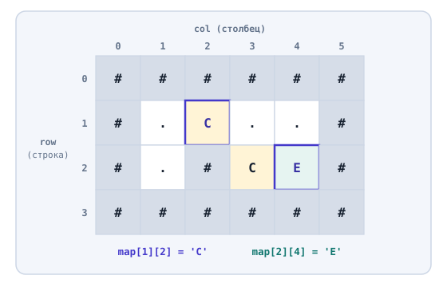
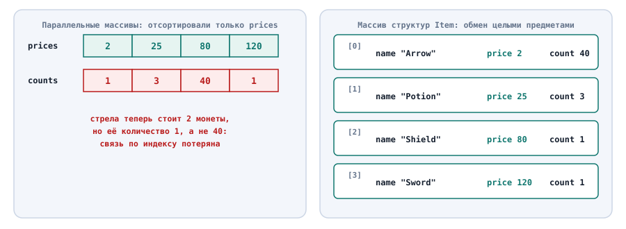
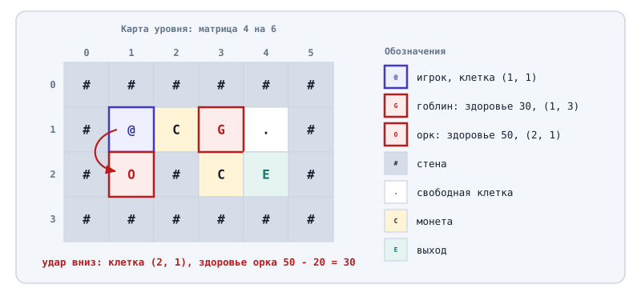
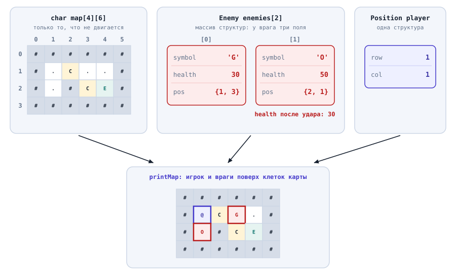
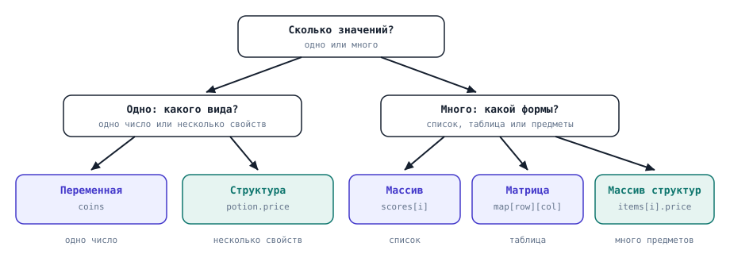

# Структуры данных. Матрицы и структуры

## Содержание

- [Структуры данных. Матрицы и структуры](#структуры-данных-матрицы-и-структуры)
  - [Содержание](#содержание)
  - [Вопросы для самопроверки](#вопросы-для-самопроверки)
  - [Ретроспектива](#ретроспектива)
  - [Двумерный массив](#двумерный-массив)
    - [Что такое двумерный массив](#что-такое-двумерный-массив)
    - [Объявление и начальные значения](#объявление-и-начальные-значения)
    - [Доступ к клетке](#доступ-к-клетке)
  - [Обход двумерного массива](#обход-двумерного-массива)
    - [Поиск клетки](#поиск-клетки)
  - [Двумерные массивы и функции](#двумерные-массивы-и-функции)
    - [Двумерный массив как параметр](#двумерный-массив-как-параметр)
    - [Пример: проверка соседних клеток и границ карты](#пример-проверка-соседних-клеток-и-границ-карты)
  - [Многомерные массивы и матрицы](#многомерные-массивы-и-матрицы)
    - [Многомерный массив](#многомерный-массив)
    - [Матрица](#матрица)
  - [Структура](#структура)
    - [Что такое структура](#что-такое-структура)
    - [Строки текста std::string](#строки-текста-stdstring)
    - [Объявление структуры](#объявление-структуры)
    - [Доступ к полям](#доступ-к-полям)
    - [Значения полей по умолчанию](#значения-полей-по-умолчанию)
    - [Копирование структуры](#копирование-структуры)
  - [Структуры и функции](#структуры-и-функции)
    - [Структура передаётся копией](#структура-передаётся-копией)
    - [Функция возвращает структуру](#функция-возвращает-структуру)
    - [Структура внутри структуры](#структура-внутри-структуры)
  - [Массив структур](#массив-структур)
    - [Инвентарь как массив структур](#инвентарь-как-массив-структур)
    - [Сортировка массива структур](#сортировка-массива-структур)
    - [Структуры и матрица в отладчике](#структуры-и-матрица-в-отладчике)
  - [Пример. Враги на карте](#пример-враги-на-карте)
  - [Как выбрать структуру данных](#как-выбрать-структуру-данных)
  - [Типичные ошибки](#типичные-ошибки)
  - [Резюме](#резюме)

## Вопросы для самопроверки

1. Какие данные игры удобно хранить в двумерном массиве, а не в одномерном?
2. В двумерном массиве `char map[4][6]` что обозначают числа `4` и `6`? Какой индекс у правой нижней клетки?
3. Почему при обходе двумерного массива нужны два вложенных цикла и что перебирает каждый из них?
4. Какой размер можно опустить, когда двумерный или трёхмерный массив передают в функцию, какие нельзя и почему?
5. Сколько индексов нужно, чтобы обратиться к элементу трёхмерного массива? Как ещё называют двумерный массив?
6. Какую проблему параллельных массивов решает структура? Почему после сортировки массива структур название предмета остаётся рядом с его ценой?
7. Функция `void useItem(Item item)` уменьшает `item.count`, но в `main` количество не меняется. Почему и как это исправить?
8. Как функция может вернуть сразу два числа, например строку и столбец найденной клетки?
9. Какую структуру данных выбрать для очков за уровни, для карты уровня, для одного предмета и для всего инвентаря?

## Ретроспектива

В прошлой главе однотипные значения хранились в массиве: очки за уровни, предметы в рюкзаке. Обход, поиск и сортировка работали с массивом через индекс, а функции получали массив вместе с его размером.

Две задачи массив решает плохо:

- _Данные в виде таблицы_. Карта уровня состоит из строк и столбцов, и клетку удобно задавать двумя номерами, а не одним.
- _Несколько свойств одного предмета_. После сортировки массива очков в прошлой главе стало непонятно, какому игроку принадлежит каждый результат. Та же проблема ждёт предмет с названием, ценой и количеством: эти свойства должны оставаться вместе.

Первую задачу решает двумерный массив, вторую - структура. В конце главы двумерный массив и структура работают вместе в одной программе.

## Двумерный массив

Многие данные в играх и в жизни выглядят как таблица:

- клетки игрового поля,
- места в зрительном зале,
- оценки студентов по предметам.

Одномерный массив может хранить такую таблицу, если записать строки одну за другой. Но тогда клетку из строки `row` и столбца `col` придётся искать по индексу `row * COLS + col`, где `COLS` - количество столбцов. Такую формулу легко написать с ошибкой. Удобнее, когда сама структура данных знает про строки и столбцы.

### Что такое двумерный массив

**Двумерный массив (two-dimensional array)** - массив, каждый элемент которого сам - массив той же длины[^1]. Его удобно представлять как прямоугольную таблицу:

- внешний массив - это строки таблицы,
- каждая строка - массив значений по столбцам.

При рассмотрении двумерного массива выделяют строки и столбцы:

- _Строка (row)_ - горизонтальный ряд таблицы. Её номер называют индексом строки.
- _Столбец (column)_ - вертикальный ряд таблицы. Его номер называют индексом столбца.

Как и в одномерном массиве, оба индекса начинаются с нуля. Каждое значение стоит на пересечении одной строки и одного столбца, поэтому для обращения к нему нужны два индекса.

Двумерный массив выбирают, когда все значения одного типа, а положение каждого задаётся двумя номерами: строкой и столбцом. Так устроены клетки карты и места в зале. Если столбцы таблицы различаются по смыслу и типу, как название, цена и количество предмета, нужен массив, каждый элемент которого хранит несколько разных значений.

Рассмотрим пример. Карта небольшого уровня в двумерной игре состоит из клеток. Каждую клетку обозначает символ:

| Символ | Что в клетке  |
| ------ | ------------- |
| `#`    | Стена         |
| `.`    | Пол           |
| `C`    | Монета (coin) |
| `E`    | Выход (exit)  |



_Рисунок 10.1. Карта уровня как двумерный массив из 4 строк и 6 столбцов_

На рисунке 10.1 карта состоит из четырёх строк и шести столбцов. Слева подписаны индексы строк от `0` до `3`, сверху - индексы столбцов от `0` до `5`. Монета стоит на пересечении строки `1` и столбца `2`: строка с индексом `1` - вторая сверху, потому что отсчёт идёт с нуля. Выход стоит в строке `2` и столбце `4`.

### Объявление и начальные значения

Двумерный массив объявляется с двумя размерами в квадратных скобках: сначала количество строк, потом количество столбцов. Начальные значения задают вложенными фигурными скобками, по одной паре на каждую строку[^1]:

```cpp
const int ROWS = 4;
const int COLS = 6;

char map[ROWS][COLS] = {
    {'#', '#', '#', '#', '#', '#'},
    {'#', '.', 'C', '.', '.', '#'},
    {'#', '.', '#', 'C', 'E', '#'},
    {'#', '#', '#', '#', '#', '#'}
};
```

Размеры `ROWS` и `COLS`, как и размер одномерного массива, должны быть константами.

> [!NOTE]
>
> Пустые скобки `= {}` заполняют весь двумерный массив нулями. Локальный двумерный массив без фигурных скобок содержит мусор, и читать такие клетки до первой записи нельзя.

### Доступ к клетке

К клетке обращаются двумя индексами в отдельных квадратных скобках: `map[row][col]`. Первый индекс выбирает строку, второй - столбец в этой строке.

Рассмотрим пример.

```cpp
std::cout << map[1][2] << '\n';    // C
std::cout << map[2][4] << '\n';    // E

map[1][2] = '.';
```

- Выражение `map[1][2]` берёт строку `1`, а в ней столбец `2`: это монета `C`.
- Выражение `map[2][4]` выводит `E`.
- Присваивание `map[1][2] = '.'` записывает в клетку точку `'.'` - то есть пол: игрок подобрал монету, и её больше нет на карте.

> [!NOTE]
>
> Главная ошибка здесь - перепутать порядок индексов.
>
> В играх положение обычно описывают координатами `x` (по горизонтали) и `y` (по вертикали).
>
> - _Горизонталь - это столбец_,
> - _Вертикаль - строка_.
>
> Клетка с координатами `x = 4`, `y = 2` записывается как `map[2][4]`: сначала `y`, потом `x`. Чтобы не путаться, в этой главе переменные называются `row` и `col`, а не `x` и `y`.

## Обход двумерного массива

Двумерный массив, как и одномерный, обычно нужно обработать целиком: вывести, посчитать или найти клетки.

**Обход двумерного массива** - последовательная обработка всех его элементов. Его записывают двумя вложенными циклами из шестой главы:

- внешний цикл перебирает строки,
- внутренний - столбцы текущей строки:

```cpp
for (int row = 0; row < ROWS; row++) {
    for (int col = 0; col < COLS; col++) {
        // действие с клеткой map[row][col]
    }
}
```

Для каждого значения `row` внутренний цикл проходит все `COLS` столбцов. Внутренний цикл успевает пройти всю строку, прежде чем внешний перейдёт к следующей:

| `row` | `col` | `map[row][col]` |
| ----: | ----: | --------------- |
|     0 |     0 | `#`             |
|     0 |     1 | `#`             |
|   ... |   ... | ...             |
|     0 |     5 | `#`             |
|     1 |     0 | `#`             |
|     1 |     1 | `.`             |

Рассмотрим, как внутренний и внешний циклы проходят по клеткам.

Чтобы вывести карту:

1. Программа печатает каждую клетку без пробела,
2. После каждой строки переходит на новую строку.

Рассмотрим пример:

```cpp
for (int row = 0; row < ROWS; row++) {
    for (int col = 0; col < COLS; col++) {
        std::cout << map[row][col];
    }
    std::cout << '\n';
}
```

Результат:

```text
######
#....#
#.#CE#
######
```

Вывод `'\n'` стоит после внутреннего цикла, но внутри внешнего. Поэтому перевод строки печатается один раз после шести символов строки. Если перенести его внутрь внутреннего цикла, каждая клетка окажется на отдельной строке экрана.

### Поиск клетки

Чтобы найти клетку, программа перебирает все клетки и запоминает строку и столбец той, в которой стоит нужный символ.

Рассмотрим пример поиска выхода на карте:

```cpp
int exitRow = -1;
int exitCol = -1;

for (int row = 0; row < ROWS; row++) {
    for (int col = 0; col < COLS; col++) {
        if (map[row][col] == 'E') {
            exitRow = row;
            exitCol = col;
        }
    }
}

std::cout << "Exit: row " << exitRow << ", column " << exitCol << '\n';
```

- Программа выводит `Exit: row 2, column 4`.
- Значения `-1` до циклов означают "выход не найден", как в линейном поиске из прошлой главы.

Результат поиска - два числа, а не одно, так как мы ищем координаты клетки, а не одно значение. Это создаёт две трудности

- _Поиск неудобно вынести в функцию_. Функция возвращает через `return` одно значение, а здесь их два.
- _Поиск не останавливается на найденной клетке_. Инструкция `break` из шестой главы выходит только из внутреннего цикла, и внешний цикл продолжает работу.

Если бы на карте было два выхода, программа запомнила бы последний и продолжала бы проверять клетки после первого найденного.

- Первую трудность решает структура - тип, который объединяет несколько значений, например строку и столбец, в одно.
- Вторую решает инструкция `return` в функции поиска.

## Двумерные массивы и функции

Как и с одномерными массивами в прошлой главе, вывод карты и проверку хода удобно вынести в функции.

### Двумерный массив как параметр

Двумерный массив передают в функцию так же, как одномерный: _функция получает доступ к исходным клеткам_, и изменения видны в вызывающем коде. Отличается запись параметра, при передаче двумерного массива, необходимо указывать:

- Количество строк можно не указывать,
- Количество столбцов нужно указывать обязательно[^2]:

```cpp
void printMap(char map[][COLS], int rows, int playerRow, int playerCol)
```

Рассмотрим пример. Функция выводит карту и рисует игрока символом `@` поверх клетки, в которой он стоит:

```cpp
#include <iostream>

const int ROWS = 4;
const int COLS = 6;

void printMap(char map[][COLS], int rows, int playerRow, int playerCol) {
    for (int row = 0; row < rows; row++) {
        for (int col = 0; col < COLS; col++) {
            if (row == playerRow && col == playerCol) {
                std::cout << '@';
            } else {
                std::cout << map[row][col];
            }
        }
        std::cout << '\n';
    }
}
```

Игрок стоит в строке `1` и столбце `1`, и при вызове `printMap(map, ROWS, 1, 1)` для исходной карты функция выводит:

```text
######
#@C..#
#.#CE#
######
```

Игрок не записан в саму карту. Его положение хранится в двух переменных, и функция только рисует его поверх пола. Так при перемещении игрока карту менять не нужно.

### Пример: проверка соседних клеток и границ карты

Перед каждым ходом игра проверяет клетку, в которую игрок хочет пойти. Соседи клетки `map[row][col]` по четырём направлениям получаются изменением одного индекса на единицу. Строки нумеруются сверху вниз, поэтому вверх - это строка с меньшим номером:

| Направление | Строка    | Столбец   |
| ----------- | --------- | --------- |
| Вверх       | `row - 1` | `col`     |
| Вниз        | `row + 1` | `col`     |
| Влево       | `row`     | `col - 1` |
| Вправо      | `row`     | `col + 1` |

У клетки на краю карты некоторых соседей нет. Если не проверить индексы, программа выйдет за границы массива. Поэтому проверка хода состоит из двух шагов: сначала клетка должна быть внутри карты, потом она не должна быть стеной.

```cpp
bool canMoveTo(char map[][COLS], int rows, int row, int col) {
    if (row < 0 || row >= rows || col < 0 || col >= COLS) {
        return false;
    }

    return map[row][col] != '#';
}
```

Условия `row < 0` и `col < 0` означают клетку выше или левее карты, а `row >= rows` и `col >= COLS` - ниже или правее. Здесь нужно сравнение `>=`, а не `>`: последний индекс строки равен `rows - 1`.

Игрок стоит в клетке `(1, 1)`:

- строка `1`,
- столбец `1`.

Проверим две соседние клетки и одну клетку за пределами карты:

| Вызов                        | Что проверяем    | Результат | Почему                                          |
| ---------------------------- | ---------------- | --------- | ----------------------------------------------- |
| `canMoveTo(map, ROWS, 1, 2)` | Ход вправо       | `true`    | Внутри карты, в клетке монета                   |
| `canMoveTo(map, ROWS, 0, 1)` | Ход вверх        | `false`   | В клетке стена `#`                              |
| `canMoveTo(map, ROWS, 5, 1)` | Индекс вне карты | `false`   | Строки `5` нет, к массиву функция не обращается |

Программа выводит эти результаты как `1`, `0` и `0`: так `std::cout` печатает значения `true` и `false`.

Порядок проверок важен. Если сначала прочитать `map[row][col]`, а потом проверить границы, то при `row = 5` программа уже успеет выйти за границы массива.

## Многомерные массивы и матрицы

Двух индексов хватает не всегда. В игре с несколькими этажами у каждого этажа своя карта, и чтобы указать клетку, нужны три номера: этаж, строка и столбец.

### Многомерный массив

**Многомерный массив (multidimensional array)** - массив, элементы которого сами - массивы[^1]. Количество индексов, которые нужны, чтобы добраться до одного значения, называют _размерностью (number of dimensions)_ массива. Массив с одним индексом называют одномерным, с двумя - двумерным, с `N` индексами - `N`-мерным.

| Массив     | Индексов | Пример объявления       | Что хранит                    |
| ---------- | -------: | ----------------------- | ----------------------------- |
| Одномерный |        1 | `int scores[5]`         | Очки за пять уровней          |
| Двумерный  |        2 | `char map[4][6]`        | Карту одного уровня           |
| Трёхмерный |        3 | `char dungeon[2][3][5]` | Карты двух уровней подземелья |

Например, **Трёхмерный массив** - массив двумерных массивов. Каждый новый размер в объявлении добавляет ещё одну пару квадратных скобок, ещё один индекс при обращении и ещё один вложенный цикл при обходе.

Рассмотрим пример. Подземелье состоит из двух уровней, и каждый уровень - карта из трёх строк и пяти столбцов. Символ `S` обозначает лестницу (stairs) между уровнями. Программа не перемещает игрока по лестнице: она только читает клетки и считает монеты.

```cpp
const int LEVELS = 2;
const int ROWS = 3;
const int COLS = 5;

char dungeon[LEVELS][ROWS][COLS] = {
    {
        {'#', '#', '#', '#', '#'},
        {'#', 'C', '.', 'S', '#'},
        {'#', '#', '#', '#', '#'}
    },
    {
        {'#', '#', '#', '#', '#'},
        {'#', 'S', 'C', 'E', '#'},
        {'#', '#', '#', '#', '#'}
    }
};

std::cout << dungeon[1][1][3] << '\n';    // E

int coins = 0;

for (int level = 0; level < LEVELS; level++) {
    for (int row = 0; row < ROWS; row++) {
        for (int col = 0; col < COLS; col++) {
            if (dungeon[level][row][col] == 'C') {
                coins++;
            }
        }
    }
}

std::cout << "Coins in the dungeon: " << coins << '\n';
```

Разберём программу по шагам:

1. Внешние фигурные скобки содержат две пары скобок - два уровня. Каждый уровень содержит три пары скобок - три строки по пять символов.
2. `dungeon[1][1][3]` выбирает уровень `1`, в нём строку `1`, в ней столбец `3`. Там стоит выход, и программа выводит `E`.
3. Три вложенных цикла перебирают уровни, строки и столбцы. Тело внутреннего цикла выполняется `2 * 3 * 5 = 30` раз, по одному разу для каждой клетки подземелья.
4. Монеты стоят в клетках `dungeon[0][1][1]` и `dungeon[1][1][2]`, поэтому программа выводит `Coins in the dungeon: 2`.

Чем больше индексов, тем легче перепутать их порядок. Дальше в главе используются только одномерные и двумерные массивы.

### Матрица

Двумерный массив встречается в программах так часто, что у него есть своё короткое название.

**Матрица (matrix)** - одно из названийдвумерного массива. Слово пришло из математики, где матрицей называют прямоугольную таблицу чисел из `m` строк и `n` столбцов[^3]. Размер матрицы записывают как "строки на столбцы": карта `char map[4][6]` - матрица 4 на 6. В этой главе над матрицами не выполняют математических действий, слово только называет таблицу.

Вместе с названием меняются и имена частей. Строку двумерного массива `map[row]` называют строкой матрицы, клетку `map[row][col]` - элементом матрицы, а обход двумя вложенными циклами - обходом матрицы.

## Структура

Матрица решает задачу таблицы, но не задачу предмета с несколькими свойствами. У предмета в инвентаре есть цена и количество, и эти значения описывают одну вещь. Средствами прошлой главы такие данные можно хранить только в нескольких массивах, по одному на свойство.

**Параллельные массивы (parallel arrays)** - несколько массивов одного размера, в которых элементы с одинаковым индексом описывают один и тот же предмет.

Рассмотрим пример. В инвентаре четыре предмета: меч, зелья, стрелы и щит.

```cpp
int prices[4] = {120, 25, 2, 80};
int counts[4] = {1, 3, 40, 1};
```

Предмет с индексом `1` - зелье: оно стоит `prices[1] = 25` монет, и в рюкзаке их `counts[1] = 3`. Названий в этих массивах нет: для текста пока не было типа.

У параллельных массивов три слабых места:

- _Связь держится только на индексах_. Если отсортировать `prices`, а `counts` забыть, количества окажутся у чужих предметов.
- _Функциям нужно много параметров_. Каждое новое свойство - ещё один массив и ещё один параметр в каждой функции.
- _Один предмет нельзя передать целиком_. Нет переменной, которая означает "этот предмет". Приходится передавать все массивы и индекс, например чтобы передать зелье в функцию, нужно передать `prices`, `counts` и `1` (индекс предмета).

### Что такое структура

**Структура (struct)** - тип данных, который программист создаёт сам и который объединяет несколько переменных, возможно разных типов, под одним именем[^4][^5].

**Поле (field, member)** - переменная внутри структуры. У каждого поля есть тип и имя, как у обычной переменной.

Структура описывает, из чего состоит предмет, а переменная этого типа хранит данные конкретного предмета. Так тип `int` описывает "целое число", а переменная `price` хранит число `25`.

_Структуру выбирают, когда у одной вещи есть несколько свойств, которые всегда нужны вместе_: у предмета - название, цена и количество, у клетки карты - строка и столбец.

Рассмотрим пример из жизни. Карточка товара в магазине содержит:

- название,
- цену,
- количество на складе.

Описание "у каждой карточки есть эти три поля" - это структура. Карточка "Зелье, 25 монет, 3 штуки" - переменная этой структуры.

### Строки текста std::string

У предмета есть название, а для текста нужен свой тип данных. Текст в двойных кавычках уже встречался в `std::cout`, но сохранить его в переменной было нельзя: тип `char` из третьей главы хранит один символ.

**Строка текста (string)** - последовательность символов, которую программа хранит как одно значение. В C++ для неё есть тип стандартной библиотеки `std::string`[^6]. Чтобы его использовать, в начало программы добавляют `#include <string>`.

В этой главе со строками выполняются всего три действия:

```cpp
std::string name = "Potion";    // создать строку из литерала в двойных кавычках
std::cout << name << '\n';      // вывести: Potion
if (name == "Potion") { }       // сравнить с другой строкой
```

_Строковый литерал (string literal)_ записывается в двойных кавычках, а символьный, как в третьей главе, в одинарных: `"Potion"` - строка текста, `'P'` - один символ.

Слово "строка" в этой главе обозначает две разные вещи: строку матрицы (row) и строку текста (string). Строка матрицы - ряд клеток, строка текста - значение типа `std::string`.

### Объявление структуры

Структуру объявляют словом `struct`, за которым идут _имя нового типа_ и _список полей в фигурных скобках_.

Рассмотрим пример:

```cpp
#include <iostream>
#include <string>

struct Item {
    std::string name;
    int price;
    int count;
};
// после закрывающей скобки структуры ставится точка с запятой

int main() {
    Item potion = {"Potion", 25, 3};

    std::cout << potion.name << ": " << potion.price << " coins, x" << potion.count << '\n';

    potion.count--;
    std::cout << "Left: " << potion.count << '\n';

    return 0;
}
```

Результат:

```text
Potion: 25 coins, x3
Left: 2
```

Разберём программу по шагам:

1. `struct Item { ... };` создаёт новый тип `Item` с тремя полями:
   1. название `name`,
   2. цена `price`,
   3. количество `count`.
2. `Item potion = {"Potion", 25, 3};` объявляет переменную `potion` типа `Item`. Значения в фигурных скобках попадают в поля по порядку их объявления: `"Potion"` - в `name`, `25` - в `price`, `3` - в `count`[^7].
3. `potion.name`, `potion.price` и `potion.count` обращаются к полям, и программа выводит `Potion: 25 coins, x3`.
4. `potion.count--` уменьшает количество на единицу: игрок выпил одно зелье, и осталось `2`.

Имена типов-структур в этом курсе пишутся с большой буквы (`Item`, `Position`), чтобы их было легко отличить от переменных (`potion`, `sword`). Структуру объявляют вне функций, в начале файла: тогда тип `Item` могут использовать и `main`, и все функции ниже.

### Доступ к полям

Чтобы обратиться к полю, после имени переменной ставят точку и имя поля: `potion.price`.

**Операция доступа к полю (member access operator)** - точка `.`, которая выбирает одно поле из структуры[^8]. Поле ведёт себя как обычная переменная своего типа: его можно вывести, использовать в выражении, изменить присваиванием.

```cpp
potion.price = 30;                      // зелье подорожало
int cost = potion.price * 2;            // цена двух зелий: 60
```

> [!NOTE]
>
> Типичная ошибка - обратиться к полю через имя типа: `Item.price`. Тип `Item` - это описание, у него нет значений. Значения есть только у переменной: `potion.price`.

### Значения полей по умолчанию

Если создать локальную переменную структуры без фигурных скобок (`Item slot;`), её числовые поля содержат мусор, как у обычных локальных переменных. Для пустой ячейки инвентаря это плохо: она получила бы случайную цену. Разумное значение по умолчанию можно задать прямо в объявлении структуры.

**Инициализатор поля по умолчанию (default member initializer)** - значение, которое поле получает, если при создании переменной для него не указано другое значение[^7].

Рассмотрим пример.

```cpp
struct Item {
    std::string name = "Empty";
    int price = 0;
    int count = 0;
};

Item slot;
Item sword = {"Sword", 120};
```

Программа выводит две строки:

```text
Empty 0 0
Sword 120 0
```

- Переменная `slot` создана без значений, и все три поля получили значения по умолчанию, так что получилась пустая ячейка инвентаря.
- Для `sword` указаны два значения: название и цена. Поле `count` в списке не указано, поэтому взяло значение по умолчанию `0`.

### Копирование структуры

В прошлой главе массив нельзя было присвоить другому массиву целиком. Структуру можно: присваивание копирует все поля, одно за другим[^10].

Рассмотрим пример. В сундуке лежат такие же зелья, только больше:

```cpp
Item potion = {"Potion", 25, 3};
Item chestLoot = potion;

chestLoot.count = 10;
```

В данном примере `chestLoot` создаётся как копия `potion`. То есть,

- `chestLoot.count` будет 10,
- `potion.count` останется 3, так как изменение `chestLoot` не затронуло оригинал.

## Структуры и функции

Структура - такой же тип, как `int`, поэтому её можно передавать в функцию и возвращать из неё.

### Структура передаётся копией

Структуру можно передать в функцию целиком, одним параметром. Структура передаётся так же, как любой простой тип - по значению: параметр получает копию всех полей.

Рассмотрим пример. Функция должна использовать один предмет из стопки. _Эта программа содержит ошибку_.

```cpp
struct Item {
    std::string name;
    int price;
    int count;
};

void useItem(Item item) {
    if (item.count > 0) {
        item.count--;
    }
}

int main() {
    Item potion = {"Potion", 25, 3};

    useItem(potion);
    std::cout << potion.name << " x" << potion.count << '\n';

    return 0;
}
```

- Программа выводит `Potion x3`, хотя зелье использовано.
- Параметр `item` - копия `potion`.

Функция уменьшила количество в копии до `2`, а после завершения функции копия исчезла.

Исправление то же: функция возвращает изменённую структуру, а вызывающий код записывает её обратно .

```cpp
Item useItem(Item item) {
    if (item.count > 0) {
        item.count--;
    }

    return item;
}

int main() {
    Item potion = {"Potion", 25, 3};

    potion = useItem(potion);
    std::cout << potion.name << " x" << potion.count << '\n';

    return 0;
}
```

Теперь программа выводит `Potion x2`.

- Тип результата функции - `Item`,
- `return item` возвращает изменённую копию целиком.
- Присваивание `potion = useItem(potion)` копирует все её поля обратно в `potion`.

| Что передаётся | Получает ли функция копию        | Видны ли изменения в вызывающем коде |
| -------------- | -------------------------------- | ------------------------------------ |
| `int`          | Да                               | Нет, нужен `return`                  |
| Структура      | Да, всех полей                   | Нет, нужен `return`                  |
| Массив         | Нет, доступ к исходным элементам | Да                                   |

### Функция возвращает структуру

Как было показано ранее, функция может возвращать структуру целиком.

Например, функция может возвращать положение символа на карте в виде структуры `Position`.

Сначала объявляют структуру для положения на карте:

```cpp
struct Position {
    int row;
    int col;
};
```

Рассмотрим пример.

```cpp
Position findSymbol(char map[][COLS], int rows, char symbol) {
    for (int row = 0; row < rows; row++) {
        for (int col = 0; col < COLS; col++) {
            if (map[row][col] == symbol) {
                return {row, col};
            }
        }
    }

    return {-1, -1};
}
```

Запись `return {row, col};` создаёт значение типа `Position` прямо в инструкции `return`: строка попадает в поле `row`, столбец - в поле `col`.

Вызов в `main`:

```cpp
Position exitPos = findSymbol(map, ROWS, 'E');
std::cout << "Exit: row " << exitPos.row << ", column " << exitPos.col << '\n';

Position key = findSymbol(map, ROWS, 'K');

if (key.row == -1) {
    std::cout << "No key on this level\n";
}
```

- Программа выводит `Exit: row 2, column 4` и `No key on this level`.
- Ключа `K` на карте нет, поэтому функция дошла до `return {-1, -1}`, и проверка `key.row == -1` сработала.

> [!IMPORTANT]
>
> Рекомендуется объединять связанные данные в структуру: функция с двумя параметрами `Position` понятнее функции с четырьмя числами `row1`, `col1`, `row2`, `col2`[^12].

### Структура внутри структуры

Поле структуры может само быть структурой. Например, у врага есть символ на карте, здоровье и положение.

Положение можно описать структурой `Position`.

```cpp
struct Position {
    int row;
    int col;
};

struct Enemy {
    char symbol;
    int health;
    Position pos;
};

Enemy goblin = {'G', 30, {1, 3}};
```

- Внутренние фигурные скобки `{1, 3}` задают поле `pos`: строка `1`, столбец `3`.
- Чтобы получить строку, точку ставят дважды: `goblin.pos.row` читается как "строка в положении гоблина" и равна `1`.

Отдельная структура `Position` удобна тем, что положение врага можно одним значением передать в функцию и сравнить с клеткой карты.

## Массив структур

Одна переменная `Item` описывает один предмет. В инвентаре предметов много, и все они одного типа `Item`, а для многих однотипных значений подходит массив.

**Массив структур (array of structs)** - массив, каждый элемент которого - структура. Элемент `items[i]` - это целый предмет, а `items[i].price` - цена этого предмета. _Индекс относится к массиву, поэтому он стоит сразу после имени массива_.

### Инвентарь как массив структур

Рассмотрим пример. Объявим инвентарь из четырёх предметов:

```cpp
const int SIZE = 4;
Item inventory[SIZE] = {
    {"Sword", 120, 1},
    {"Potion", 25, 3},
    {"Arrow", 2, 40},
    {"Shield", 80, 1}
};
```

Каждая внутренняя пара скобок - один предмет. Начальные значения выглядят как таблица, в которой строка - предмет, а столбцы - поля.

Все шаблоны обхода из прошлой главы работают без изменений. Меняется только способ обратиться к значению: вместо `scores[i]` теперь `items[i].price` или `items[i].name`.

```cpp
void printInventory(Item items[], int size) {
    for (int i = 0; i < size; i++) {
        std::cout << i + 1 << ". " << items[i].name << " x" << items[i].count
                  << " (" << items[i].price << " coins)\n";
    }
}

int inventoryValue(Item items[], int size) {
    int total = 0;

    for (int i = 0; i < size; i++) {
        total = total + items[i].price * items[i].count;
    }

    return total;
}

int findItem(Item items[], int size, std::string name) {
    for (int i = 0; i < size; i++) {
        if (items[i].name == name) {
            return i;
        }
    }

    return -1;
}
```

Функция `main` вызывает эти функции и использует найденный индекс:

```cpp
printInventory(inventory, SIZE);
std::cout << "Value: " << inventoryValue(inventory, SIZE) << " coins\n";

int index = findItem(inventory, SIZE, "Potion");

if (index != -1) {
    inventory[index].count--;
    std::cout << "Potions left: " << inventory[index].count << '\n';
}
```

Результат программы:

```text
1. Sword x1 (120 coins)
2. Potion x3 (25 coins)
3. Arrow x40 (2 coins)
4. Shield x1 (80 coins)
Value: 355 coins
Potions left: 2
```

Разберём результаты:

1. `printInventory` выводит каждый предмет с номером `i + 1`.
2. `inventoryValue` складывает стоимость всех стопок: `120 * 1 + 25 * 3 + 2 * 40 + 80 * 1 = 120 + 75 + 80 + 80 = 355`.
3. `findItem(inventory, SIZE, "Potion")` возвращает индекс `1`. Это линейный поиск из прошлой главы, только сравнивается поле `name`. Затем `main` уменьшает `inventory[1].count` с `3` до `2`.

Массив структур передаётся в функцию как любой массив: функция работает с исходными элементами, и изменения полей видны в `main`.

### Сортировка массива структур

Массив структур часто упорядочивают по одному полю. Сортировка выбором из прошлой главы подходит почти без изменений. Отличаются две строки: сравниваются поля `price`, а меняются местами целые предметы.

Рассмотрим пример.

```cpp
void sortByPrice(Item items[], int size) {
    for (int i = 0; i < size - 1; i++) {
        int cheapest = i;

        for (int j = i + 1; j < size; j++) {
            if (items[j].price < items[cheapest].price) {
                cheapest = j;
            }
        }

        Item temp = items[i];
        items[i] = items[cheapest];
        items[cheapest] = temp;
    }
}
```

После сортировки `main` выводит название и цену каждого предмета:

```text
Arrow - 2
Potion - 25
Shield - 80
Sword - 120
```



_Рисунок 10.2. Параллельные массивы связаны только индексом, массив структур хранит предмет целиком_

На рисунке 10.2 слева показаны параллельные массивы `prices` и `counts`. Если отсортировать только `prices`, количества останутся на старых местах и окажутся у чужих предметов. Справа показан массив структур: каждая ячейка - целый предмет, и при обмене все его поля перемещаются вместе.

### Структуры и матрица в отладчике

Окно _Locals_ в Visual Studio (`Debug > Windows > Locals`, `Alt+4`) показывает переменную-структуру одной строкой. Стрелка слева от имени раскрывает её, и под ней появляются поля с их значениями[^13]. Массив структур и матрицу раскрывают так же, по шагам:

- Сначала элементы `[0]`, `[1]`, ..., `[n-1]`,
- Затем поля элемента или клетки строки.

Внутри функции параметр `Item items[]` отладчик показывает как адрес, так же как параметр-массив из прошлой главы. Чтобы увидеть все предметы, в окне _Watch_ вводят `items,4`, где после запятой указано количество элементов.

## Пример. Враги на карте

Рассмотрим пример. Соберём матрицу и массив структур в одну программу.

Задача: на карте уровня стоят игрок и враги, игрок бьёт врага в соседней клетке.

Карта уровня - матрица 4 на 6. Каждая клетка хранит один символ:

- `#` - стена,
- `.` - свободная клетка,
- `C` - монета,
- `E` - выход.

У каждого врага есть символ на карте, здоровье и позиция. На карте два врага:

| Враг   | Символ | Здоровье | Позиция (строка, столбец) |
| ------ | ------ | -------- | ------------------------- |
| Гоблин | `G`    | `30`     | `(1, 3)`                  |
| Орк    | `O`    | `50`     | `(2, 1)`                  |

Игрок обозначается символом `@` и стоит в клетке `(1, 1)`. Удар отнимает у врага `20` единиц здоровья.

Программа должна:

1. Вывести карту, на которой поверх клеток нарисованы игрок и враги.
2. Ударить клетку под игроком - `(2, 1)`.
3. Если в этой клетке стоит живой враг, уменьшить его здоровье и вывести, кого ударили и сколько здоровья у него осталось. Если клетка пуста, вывести `Nobody there`.



_Рисунок 10.3. Игрок в клетке (1, 1) бьёт вниз, в клетку (2, 1), где стоит орк_

На рисунке 10.3 игрок `@` выделен синей рамкой, враги - красной. Красная стрелка показывает удар: клетка под игроком на одну строку ниже, в том же столбце.

Программа состоит из трёх частей:

- `findEnemyAt` ищет живого врага в заданной клетке,
- `printMap` рисует карту, игрока и врагов,
- `main` задаёт данные и наносит удар.

```cpp
#include <iostream>

const int ROWS = 4;
const int COLS = 6;

struct Position {
    int row;
    int col;
};

struct Enemy {
    char symbol;
    int health;
    Position pos;
};

int findEnemyAt(Enemy enemies[], int count, Position cell) {
    for (int i = 0; i < count; i++) {
        if (enemies[i].health > 0 &&
            enemies[i].pos.row == cell.row &&
            enemies[i].pos.col == cell.col) {
            return i;
        }
    }

    return -1;
}

void printMap(char map[][COLS], int rows, Position player, Enemy enemies[], int count) {
    for (int row = 0; row < rows; row++) {
        for (int col = 0; col < COLS; col++) {
            Position cell = {row, col};
            int enemy = findEnemyAt(enemies, count, cell);

            if (row == player.row && col == player.col) {
                std::cout << '@';
            } else if (enemy != -1) {
                std::cout << enemies[enemy].symbol;
            } else {
                std::cout << map[row][col];
            }
        }
        std::cout << '\n';
    }
}

int main() {
    char map[ROWS][COLS] = {
        {'#', '#', '#', '#', '#', '#'},
        {'#', '.', 'C', '.', '.', '#'},
        {'#', '.', '#', 'C', 'E', '#'},
        {'#', '#', '#', '#', '#', '#'}
    };

    const int ENEMIES = 2;
    Enemy enemies[ENEMIES] = {
        {'G', 30, {1, 3}},
        {'O', 50, {2, 1}}
    };

    Position player = {1, 1};

    printMap(map, ROWS, player, enemies, ENEMIES);

    Position target = {player.row + 1, player.col};
    int index = findEnemyAt(enemies, ENEMIES, target);

    if (index != -1) {
        enemies[index].health = enemies[index].health - 20;
        std::cout << "Hit " << enemies[index].symbol
                  << ", health left: " << enemies[index].health << '\n';
    } else {
        std::cout << "Nobody there\n";
    }

    return 0;
}
```

Результат:

```text
######
#@CG.#
#O#CE#
######
Hit O, health left: 30
```

Разберём, как данные распределены по структурам:

1. _Карта_ хранится в матрице `map`. В ней только то, что не двигается: стены, пол, монеты, выход.
2. _Враги_ хранятся в массиве структур `enemies`. У каждого врага свой символ, здоровье и положение `pos`.
3. _Игрок_ - одна переменная `player` типа `Position`.



_Рисунок 10.4. Три части данных программы и вывод, который из них собирает printMap_

На рисунке 10.4 сверху три части данных. В матрице `map` нет ни игрока, ни врагов: на их местах лежит пол `.`. Враги и игрок появляются только на экране, потому что `printMap` рисует их поверх клеток карты.

Функция `printMap` для каждой клетки создаёт `Position cell` и проверяет, кто в ней стоит:

1. Если там игрок, выводится `@`.
2. Иначе, если там живой враг, выводится его символ.
3. Иначе выводится символ карты.

Поэтому гоблин виден в клетке `(1, 3)`, а орк - в клетке `(2, 1)`.

## Как выбрать структуру данных

Структуру данных выбирают по форме данных:

| Форма данных                             | Структура данных           | Пример из игры             | Как обратиться   |
| ---------------------------------------- | -------------------------- | -------------------------- | ---------------- |
| Одно значение                            | Переменная                 | Количество монет           | `coins`          |
| Много значений одного типа               | Массив                     | Очки за пять уровней       | `scores[i]`      |
| Таблица значений одного типа             | Матрица (двумерный массив) | Карта уровня               | `map[row][col]`  |
| Несколько свойств одного предмета        | Структура                  | Название, цена, количество | `potion.price`   |
| Много предметов с одинаковыми свойствами | Массив структур            | Инвентарь, отряд врагов    | `items[i].price` |

Таблица ещё не означает матрицу. Если столбцы таблицы различаются по смыслу и типу, как название, цена и количество в инвентаре, каждая её строка - предмет, и подходит массив структур.



_Рисунок 10.5. Как выбрать структуру данных_

Рисунок 10.5 показывает выбор как два вопроса. Первый вопрос - сколько значений нужно хранить: одно или много. Для одного значения второй вопрос - это одно число или несколько свойств. Для многих значений второй вопрос - их форма: простой список, таблица из клеток одного типа или список предметов с несколькими свойствами.

Структуры данных можно сочетать. В программе с врагами на карте одновременно используются:

- матрица (карта),
- массив структур (враги),
- структура внутри структуры (положение врага),
- отдельная структура (положение игрока).

Каждая часть данных хранится в той форме, которая ей подходит.

## Типичные ошибки

- _Путают порядок индексов матрицы_. Сначала строка, потом столбец: `map[row][col]`, или `map[y][x]`.
- _Проверяют стену до проверки границ_. Сначала нужно убедиться, что индексы внутри карты, и только потом читать клетку.
- _Не указывают количество столбцов в параметре_. Параметр-матрица записывается как `char map[][COLS]`, а не `char map[][]`.
- _Забывают точку с запятой после структуры_. Объявление заканчивается на `};`. Без `;` компилятор сообщит об ошибке рядом с закрывающей скобкой или на следующей строке.
- _Обращаются к полю через имя типа_. Значения есть у переменной `potion.price`, а не у типа `Item.price`.
- _Ждут, что функция изменит переданную структуру_. Структура передаётся копией, поэтому изменённую структуру возвращают через `return` и сохраняют.
- _Сравнивают структуры через `==`_. Для структур сравнение не определено, сравнивают нужные поля.
- _Пишут индекс не там_. Элемент массива структур - `items[i].price`, а не `items.price[i]`; вложенное поле - `goblin.pos.row`, а не `goblin.row`.
- _Путают порядок значений в фигурных скобках_. Запись `Item potion = {"Potion", 3, 25};` скомпилируется, но цена станет `3`, а количество `25`.
- _Путают строку матрицы и строку текста_. Строка матрицы - ряд клеток `map[row]`, строка текста - значение типа `std::string`.
- _Путают строку текста и символ_. Строковый литерал пишется в двойных кавычках `"Potion"`, а символ - в одинарных `'P'`.

## Резюме

1. Двумерный массив - массив массивов одинаковой длины, таблица из строк и столбцов, например `char map[ROWS][COLS]`. Его называют матрицей.
2. К клетке обращаются как `map[row][col]`: сначала строка, потом столбец. Матрицу обходят двумя вложенными циклами, а у `N`-мерного массива `N` индексов.
3. Перед обращением к соседней клетке проверяют, что индексы не выходят за границы карты.
4. В параметре-матрице количество столбцов указывать обязательно: `char map[][COLS]`. У `N`-мерного массива в параметре опускают только первый размер.
5. Структура объединяет несколько полей, возможно разных типов, в один новый тип; к полю обращаются через точку.
6. Структуру можно присвоить целиком, но нельзя сравнить через `==`; в функцию она передаётся копией.
7. Функция может вернуть структуру и так вернуть сразу несколько значений, например строку и столбец.
8. Массив структур хранит много однотипных предметов, и при сортировке поля каждого предмета остаются вместе.

[^1]: cppreference.com (n.d.). _Array declaration_. Available at: https://en.cppreference.com/w/cpp/language/array

[^2]: Microsoft (2025). _Arrays (C++)_. Microsoft Learn. Available at: https://learn.microsoft.com/en-us/cpp/cpp/arrays-cpp

[^3]: Weisstein, E. W. (n.d.). _Matrix_. MathWorld - A Wolfram Web Resource. Available at: https://mathworld.wolfram.com/Matrix.html

[^4]: Microsoft (2021). _struct (C++)_. Microsoft Learn. Available at: https://learn.microsoft.com/en-us/cpp/cpp/struct-cpp

[^5]: cppreference.com (n.d.). _Class declaration_. Available at: https://en.cppreference.com/w/cpp/language/class

[^6]: cppreference.com (n.d.). _std::basic_string_. Available at: https://en.cppreference.com/w/cpp/string/basic_string

[^7]: cppreference.com (n.d.). _Aggregate initialization_. Available at: https://en.cppreference.com/w/cpp/language/aggregate_initialization

[^8]: cppreference.com (n.d.). _Member access operators_. Available at: https://en.cppreference.com/w/cpp/language/operator_member_access

[^9]: Microsoft (2025). _/std (Specify Language Standard Version)_. Microsoft Learn. Available at: https://learn.microsoft.com/en-us/cpp/build/reference/std-specify-language-standard-version

[^10]: cppreference.com (n.d.). _Copy assignment operator_. Available at: https://en.cppreference.com/w/cpp/language/copy_assignment

[^11]: cppreference.com (n.d.). _Default comparisons_. Available at: https://en.cppreference.com/w/cpp/language/default_comparisons

[^12]: Stroustrup, B. and Sutter, H. (eds.) (n.d.). _C++ Core Guidelines_. Section C.1. Available at: https://isocpp.github.io/CppCoreGuidelines/CppCoreGuidelines

[^13]: Microsoft (2026). _Inspect variables - Visual Studio debugger_. Microsoft Learn. Available at: https://learn.microsoft.com/en-us/visualstudio/debugger/autos-and-locals-windows
