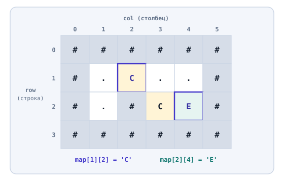

# Двумерные массивы

## Содержание

- [Двумерные массивы](#двумерные-массивы)
  - [Содержание](#содержание)
  - [Вопросы для самопроверки](#вопросы-для-самопроверки)
  - [Ретроспектива](#ретроспектива)
  - [Двумерный массив](#двумерный-массив)
    - [Что такое двумерный массив](#что-такое-двумерный-массив)
    - [Объявление и начальные значения](#объявление-и-начальные-значения)
    - [Доступ к клетке](#доступ-к-клетке)
  - [Обход двумерного массива](#обход-двумерного-массива)
    - [Поиск клетки](#поиск-клетки)
  - [Двумерные массивы и функции](#двумерные-массивы-и-функции)
    - [Двумерный массив как параметр](#двумерный-массив-как-параметр)
    - [Функция поиска клетки](#функция-поиска-клетки)
    - [Пример: проверка соседних клеток и границ карты](#пример-проверка-соседних-клеток-и-границ-карты)
  - [Многомерные массивы и матрицы](#многомерные-массивы-и-матрицы)
    - [Многомерный массив](#многомерный-массив)
    - [Матрица](#матрица)
  - [Матрица в отладчике](#матрица-в-отладчике)
  - [Типичные ошибки](#типичные-ошибки)
  - [Резюме](#резюме)

## Вопросы для самопроверки

1. Какие данные игры удобно хранить в двумерном массиве, а не в одномерном?
2. В двумерном массиве `char map[4][6]` что обозначают числа `4` и `6`? Какой индекс у правой нижней клетки?
3. Почему при обходе двумерного массива нужны два вложенных цикла и что перебирает каждый из них?
4. Какой размер можно опустить, когда двумерный или трёхмерный массив передают в функцию, какие нельзя и почему?
5. Почему `return` внутри вложенных циклов останавливает поиск на первой найденной клетке, а `break` останавливает только внутренний цикл?
6. Почему функция проверки хода сначала сравнивает индексы с границами карты и только потом читает клетку?
7. Сколько индексов нужно, чтобы обратиться к элементу трёхмерного массива? Как ещё называют двумерный массив?

## Ретроспектива

В прошлой главе однотипные значения хранились в массиве: очки за уровни, предметы в рюкзаке. Обход, поиск и сортировка работали с массивом через индекс, а функции получали массив вместе с его размером.

Массив хранит значения в один ряд, и каждое значение находится по одному номеру. Карта уровня состоит из строк и столбцов, и клетку удобно задавать двумя номерами. Для таких данных подходит двумерный массив: его объявляют, обходят вложенными циклами и передают в функции.

## Двумерный массив

Многие данные в играх и в жизни выглядят как таблица:

- клетки игрового поля,
- места в зрительном зале,
- оценки студентов по предметам.

Одномерный массив может хранить такую таблицу, если записать строки одну за другой. Но тогда клетку из строки `row` и столбца `col` придётся искать по индексу `row * COLS + col`, где `COLS` - количество столбцов. Такую формулу легко написать с ошибкой. Удобнее, когда сама структура данных знает про строки и столбцы.

### Что такое двумерный массив

**Двумерный массив (two-dimensional array)** - массив, каждый элемент которого сам - массив той же длины[^1]. Его удобно представлять как прямоугольную таблицу:

- внешний массив - это строки таблицы,
- каждая строка - массив значений по столбцам.

При рассмотрении двумерного массива выделяют строки и столбцы:

- _Строка (row)_ - горизонтальный ряд таблицы. Её номер называют индексом строки.
- _Столбец (column)_ - вертикальный ряд таблицы. Его номер называют индексом столбца.

Как и в одномерном массиве, оба индекса начинаются с нуля. Каждое значение стоит на пересечении одной строки и одного столбца, поэтому для обращения к нему нужны два индекса.

Двумерный массив выбирают, когда все значения одного типа, а положение каждого задаётся двумя номерами: строкой и столбцом. Так устроены клетки карты и места в зале. Если столбцы таблицы различаются по смыслу и типу, как название, цена и количество предмета, нужен массив, каждый элемент которого хранит несколько разных значений.

Рассмотрим пример. Карта небольшого уровня в двумерной игре состоит из клеток. Каждую клетку обозначает символ:

| Символ | Что в клетке  |
| ------ | ------------- |
| `#`    | Стена         |
| `.`    | Пол           |
| `C`    | Монета (coin) |
| `E`    | Выход (exit)  |



_Рисунок 10.1. Карта уровня как двумерный массив из 4 строк и 6 столбцов_

На рисунке 10.1 карта состоит из четырёх строк и шести столбцов. Слева подписаны индексы строк от `0` до `3`, сверху - индексы столбцов от `0` до `5`. Монета стоит на пересечении строки `1` и столбца `2`: строка с индексом `1` - вторая сверху, потому что отсчёт идёт с нуля. Выход стоит в строке `2` и столбце `4`.

### Объявление и начальные значения

Двумерный массив объявляется с двумя размерами в квадратных скобках: сначала количество строк, потом количество столбцов. Начальные значения задают вложенными фигурными скобками, по одной паре на каждую строку[^1]:

```cpp
const int ROWS = 4;
const int COLS = 6;

char map[ROWS][COLS] = {
    {'#', '#', '#', '#', '#', '#'},
    {'#', '.', 'C', '.', '.', '#'},
    {'#', '.', '#', 'C', 'E', '#'},
    {'#', '#', '#', '#', '#', '#'}
};
```

Размеры `ROWS` и `COLS`, как и размер одномерного массива, должны быть константами.

> [!NOTE]
>
> Пустые скобки `= {}` заполняют весь двумерный массив нулями. Локальный двумерный массив без фигурных скобок содержит мусор, и читать такие клетки до первой записи нельзя.

### Доступ к клетке

К клетке обращаются двумя индексами в отдельных квадратных скобках: `map[row][col]`. Первый индекс выбирает строку, второй - столбец в этой строке.

Рассмотрим пример.

```cpp
std::cout << map[1][2] << '\n';    // C
std::cout << map[2][4] << '\n';    // E

map[1][2] = '.';
```

- Выражение `map[1][2]` берёт строку `1`, а в ней столбец `2`: это монета `C`.
- Выражение `map[2][4]` выводит `E`.
- Присваивание `map[1][2] = '.'` записывает в клетку точку `'.'` - то есть пол: игрок подобрал монету, и её больше нет на карте.

> [!NOTE]
>
> Главная ошибка здесь - перепутать порядок индексов.
>
> В играх положение обычно описывают координатами `x` (по горизонтали) и `y` (по вертикали).
>
> - _Горизонталь - это столбец_,
> - _Вертикаль - строка_.
>
> Клетка с координатами `x = 4`, `y = 2` записывается как `map[2][4]`: сначала `y`, потом `x`. Чтобы не путаться, в этой главе переменные называются `row` и `col`, а не `x` и `y`.

## Обход двумерного массива

Двумерный массив, как и одномерный, обычно нужно обработать целиком: вывести, посчитать или найти клетки.

**Обход двумерного массива** - последовательная обработка всех его элементов. Его записывают двумя вложенными циклами из шестой главы:

- внешний цикл перебирает строки,
- внутренний - столбцы текущей строки:

```cpp
for (int row = 0; row < ROWS; row++) {
    for (int col = 0; col < COLS; col++) {
        // действие с клеткой map[row][col]
    }
}
```

Для каждого значения `row` внутренний цикл проходит все `COLS` столбцов. Внутренний цикл успевает пройти всю строку, прежде чем внешний перейдёт к следующей:

| `row` | `col` | `map[row][col]` |
| ----: | ----: | --------------- |
|     0 |     0 | `#`             |
|     0 |     1 | `#`             |
|   ... |   ... | ...             |
|     0 |     5 | `#`             |
|     1 |     0 | `#`             |
|     1 |     1 | `.`             |

Рассмотрим, как внутренний и внешний циклы проходят по клеткам.

Чтобы вывести карту:

1. Программа печатает каждую клетку без пробела,
2. После каждой строки переходит на новую строку.

Рассмотрим пример:

```cpp
for (int row = 0; row < ROWS; row++) {
    for (int col = 0; col < COLS; col++) {
        std::cout << map[row][col];
    }
    std::cout << '\n';
}
```

Результат:

```text
######
#....#
#.#CE#
######
```

Вывод `'\n'` стоит после внутреннего цикла, но внутри внешнего. Поэтому перевод строки печатается один раз после шести символов строки. Если перенести его внутрь внутреннего цикла, каждая клетка окажется на отдельной строке экрана.

### Поиск клетки

Чтобы найти клетку, программа перебирает все клетки и запоминает строку и столбец той, в которой стоит нужный символ.

Рассмотрим пример поиска выхода на карте:

```cpp
int exitRow = -1;
int exitCol = -1;

for (int row = 0; row < ROWS; row++) {
    for (int col = 0; col < COLS; col++) {
        if (map[row][col] == 'E') {
            exitRow = row;
            exitCol = col;
        }
    }
}

std::cout << "Exit: row " << exitRow << ", column " << exitCol << '\n';
```

- Программа выводит `Exit: row 2, column 4`.
- Значения `-1` до циклов означают "выход не найден", как в линейном поиске из прошлой главы.

Результат поиска - два числа, а не одно, так как мы ищем координаты клетки, а не одно значение. Это создаёт две трудности:

- _Поиск неудобно вынести в функцию_. Функция возвращает через `return` одно значение, а здесь их два.
- _Поиск не останавливается на найденной клетке_. Инструкция `break` из шестой главы выходит только из внутреннего цикла, и внешний цикл продолжает работу.

Если бы на карте было два выхода, программа запомнила бы последний и продолжала бы проверять клетки после первого найденного.

Вторую трудность решает инструкция `return` в функции поиска: она описана в [разделе "Функция поиска клетки"](#функция-поиска-клетки). Первую трудность решает структура - тип, который объединяет несколько значений, например строку и столбец, в одно. Структуры разбираются в следующей главе.

## Двумерные массивы и функции

Как и с одномерными массивами в прошлой главе, вывод карты и проверку хода удобно вынести в функции.

### Двумерный массив как параметр

Двумерный массив передают в функцию так же, как одномерный: _функция получает доступ к исходным клеткам_, и изменения видны в вызывающем коде. Отличается запись параметра, при передаче двумерного массива, необходимо указывать:

- Количество строк можно не указывать,
- Количество столбцов нужно указывать обязательно[^2]:

```cpp
void printMap(char map[][COLS], int rows, int playerRow, int playerCol)
```

Рассмотрим пример. Функция выводит карту и рисует игрока символом `@` поверх клетки, в которой он стоит:

```cpp
#include <iostream>

const int ROWS = 4;
const int COLS = 6;

void printMap(char map[][COLS], int rows, int playerRow, int playerCol) {
    for (int row = 0; row < rows; row++) {
        for (int col = 0; col < COLS; col++) {
            if (row == playerRow && col == playerCol) {
                std::cout << '@';
            } else {
                std::cout << map[row][col];
            }
        }
        std::cout << '\n';
    }
}
```

Игрок стоит в строке `1` и столбце `1`, и при вызове `printMap(map, ROWS, 1, 1)` для исходной карты функция выводит:

```text
######
#@C..#
#.#CE#
######
```

Игрок не записан в саму карту. Его положение хранится в двух переменных, и функция только рисует его поверх пола. Так при перемещении игрока карту менять не нужно.

### Функция поиска клетки

Поиск выхода в `main` проверяет все клетки карты, даже когда выход уже найден. Если перенести поиск в функцию, его можно остановить на первой найденной клетке. Инструкция `return` внутри вложенных циклов сразу завершает всю функцию вместе с обоими циклами.

Рассмотрим пример. Функция `hasSymbol` отвечает, есть ли на карте клетка с нужным символом:

```cpp
bool hasSymbol(char map[][COLS], int rows, char symbol) {
    for (int row = 0; row < rows; row++) {
        for (int col = 0; col < COLS; col++) {
            if (map[row][col] == symbol) {
                return true;
            }
        }
    }

    return false;
}
```

Для исходной карты уровня вызов `hasSymbol(map, ROWS, 'E')` возвращает `true`, а `hasSymbol(map, ROWS, 'K')` - `false`. Программа выводит их как `1` и `0`:

1. Для `'E'` функция доходит до клетки `map[2][4]`, и `return true` завершает её. Клетки `map[2][5]` и вся строка `3` уже не проверяются.
2. Символа `'K'` на карте нет. Функция проверяет все `4 * 6 = 24` клетки. Оба цикла заканчиваются, и выполняется `return false`.

Инструкция `break` здесь не подошла бы: она выходит только из внутреннего цикла, и внешний цикл перешёл бы к следующей строке.

Функция отвечает только "есть или нет". Вернуть через `return` ещё и строку со столбцом найденной клетки она не может: это два числа, а функция возвращает одно значение.

### Пример: проверка соседних клеток и границ карты

Перед каждым ходом игра проверяет клетку, в которую игрок хочет пойти. Соседи клетки `map[row][col]` по четырём направлениям получаются изменением одного индекса на единицу. Строки нумеруются сверху вниз, поэтому вверх - это строка с меньшим номером:

| Направление | Строка    | Столбец   |
| ----------- | --------- | --------- |
| Вверх       | `row - 1` | `col`     |
| Вниз        | `row + 1` | `col`     |
| Влево       | `row`     | `col - 1` |
| Вправо      | `row`     | `col + 1` |

У клетки на краю карты некоторых соседей нет. Если не проверить индексы, программа выйдет за границы массива. Поэтому проверка хода состоит из двух шагов: сначала клетка должна быть внутри карты, потом она не должна быть стеной.

```cpp
bool canMoveTo(char map[][COLS], int rows, int row, int col) {
    if (row < 0 || row >= rows || col < 0 || col >= COLS) {
        return false;
    }

    return map[row][col] != '#';
}
```

Условия `row < 0` и `col < 0` означают клетку выше или левее карты, а `row >= rows` и `col >= COLS` - ниже или правее. Здесь нужно сравнение `>=`, а не `>`: последний индекс строки равен `rows - 1`.

Игрок стоит в клетке `(1, 1)`:

- строка `1`,
- столбец `1`.

Проверим две соседние клетки и одну клетку за пределами карты:

| Вызов                        | Что проверяем    | Результат | Почему                                          |
| ---------------------------- | ---------------- | --------- | ----------------------------------------------- |
| `canMoveTo(map, ROWS, 1, 2)` | Ход вправо       | `true`    | Внутри карты, в клетке монета                   |
| `canMoveTo(map, ROWS, 0, 1)` | Ход вверх        | `false`   | В клетке стена `#`                              |
| `canMoveTo(map, ROWS, 5, 1)` | Индекс вне карты | `false`   | Строки `5` нет, к массиву функция не обращается |

Программа выводит эти результаты как `1`, `0` и `0`: так `std::cout` печатает значения `true` и `false`.

Порядок проверок важен. Если сначала прочитать `map[row][col]`, а потом проверить границы, то при `row = 5` программа уже успеет выйти за границы массива.

## Многомерные массивы и матрицы

Двух индексов хватает не всегда. В игре с несколькими этажами у каждого этажа своя карта, и чтобы указать клетку, нужны три номера: этаж, строка и столбец.

### Многомерный массив

**Многомерный массив (multidimensional array)** - массив, элементы которого сами - массивы[^1]. Количество индексов, которые нужны, чтобы добраться до одного значения, называют _размерностью (number of dimensions)_ массива. Массив с одним индексом называют одномерным, с двумя - двумерным, с `N` индексами - `N`-мерным.

| Массив     | Индексов | Пример объявления       | Что хранит                    |
| ---------- | -------: | ----------------------- | ----------------------------- |
| Одномерный |        1 | `int scores[5]`         | Очки за пять уровней          |
| Двумерный  |        2 | `char map[4][6]`        | Карту одного уровня           |
| Трёхмерный |        3 | `char dungeon[2][3][5]` | Карты двух уровней подземелья |

Например, **Трёхмерный массив** - массив двумерных массивов. Каждый новый размер в объявлении добавляет ещё одну пару квадратных скобок, ещё один индекс при обращении и ещё один вложенный цикл при обходе.

Рассмотрим пример. Подземелье состоит из двух уровней, и каждый уровень - карта из трёх строк и пяти столбцов. Символ `S` обозначает лестницу (stairs) между уровнями. Программа не перемещает игрока по лестнице: она только читает клетки и считает монеты.

```cpp
const int LEVELS = 2;
const int ROWS = 3;
const int COLS = 5;

char dungeon[LEVELS][ROWS][COLS] = {
    {
        {'#', '#', '#', '#', '#'},
        {'#', 'C', '.', 'S', '#'},
        {'#', '#', '#', '#', '#'}
    },
    {
        {'#', '#', '#', '#', '#'},
        {'#', 'S', 'C', 'E', '#'},
        {'#', '#', '#', '#', '#'}
    }
};

std::cout << dungeon[1][1][3] << '\n';    // E

int coins = 0;

for (int level = 0; level < LEVELS; level++) {
    for (int row = 0; row < ROWS; row++) {
        for (int col = 0; col < COLS; col++) {
            if (dungeon[level][row][col] == 'C') {
                coins++;
            }
        }
    }
}

std::cout << "Coins in the dungeon: " << coins << '\n';
```

Разберём программу по шагам:

1. Внешние фигурные скобки содержат две пары скобок - два уровня. Каждый уровень содержит три пары скобок - три строки по пять символов.
2. `dungeon[1][1][3]` выбирает уровень `1`, в нём строку `1`, в ней столбец `3`. Там стоит выход, и программа выводит `E`.
3. Три вложенных цикла перебирают уровни, строки и столбцы. Тело внутреннего цикла выполняется `2 * 3 * 5 = 30` раз, по одному разу для каждой клетки подземелья.
4. Монеты стоят в клетках `dungeon[0][1][1]` и `dungeon[1][1][2]`, поэтому программа выводит `Coins in the dungeon: 2`.

Чем больше индексов, тем легче перепутать их порядок. Дальше в главе используются только одномерные и двумерные массивы.

### Матрица

Двумерный массив встречается в программах так часто, что у него есть своё короткое название.

**Матрица (matrix)** - одно из названий двумерного массива. Слово пришло из математики, где матрицей называют прямоугольную таблицу чисел из `m` строк и `n` столбцов[^3]. Размер матрицы записывают как "строки на столбцы": карта `char map[4][6]` - матрица 4 на 6. В этой главе над матрицами не выполняют математических действий, слово только называет таблицу.

Вместе с названием меняются и имена частей. Строку двумерного массива `map[row]` называют строкой матрицы, клетку `map[row][col]` - элементом матрицы, а обход двумя вложенными циклами - обходом матрицы.

## Матрица в отладчике

Окно _Locals_ в Visual Studio (`Debug > Windows > Locals`, `Alt+4`) показывает матрицу `map` одной записью. Стрелка слева от имени раскрывает её по шагам[^4]:

1. Сначала в окне появляются строки матрицы `[0]`, `[1]`, `[2]`, `[3]`.
2. Затем каждую строку можно раскрыть: под ней появляются её элементы `[0]`, ..., `[5]` с символами клеток.

Внутри функции параметр `char map[][COLS]` отладчик показывает как адрес, как и параметр-массив из прошлой главы. Чтобы увидеть все строки карты, в окне _Watch_ вводят `map,4`, где после запятой указано количество строк[^5].

## Типичные ошибки

- _Путают порядок индексов матрицы_. Сначала строка, потом столбец: `map[row][col]`, или `map[y][x]`.
- _Ставят перевод строки не в тот цикл_. При выводе карты `'\n'` должен стоять после внутреннего цикла, но внутри внешнего. Если поставить его внутрь внутреннего цикла, каждая клетка окажется на отдельной строке экрана.
- _Останавливают поиск через `break`_. Инструкция `break` завершает только внутренний цикл, и внешний продолжает перебирать строки. Чтобы остановить поиск целиком, его выносят в функцию и завершают через `return`.
- _Проверяют стену до проверки границ_. Сначала нужно убедиться, что индексы внутри карты, и только потом читать клетку.
- _Не указывают количество столбцов в параметре_. Параметр-матрица записывается как `char map[][COLS]`, а не `char map[][]`.

## Резюме

1. Двумерный массив - массив массивов одинаковой длины, таблица из строк и столбцов, например `char map[ROWS][COLS]`. Его называют матрицей.
2. К клетке обращаются как `map[row][col]`: сначала строка, потом столбец. Матрицу обходят двумя вложенными циклами, а у `N`-мерного массива `N` индексов.
3. Инструкция `return` внутри вложенных циклов завершает всю функцию, и поиск останавливается на первой найденной клетке. Инструкция `break` выходит только из внутреннего цикла.
4. Перед обращением к соседней клетке проверяют, что индексы не выходят за границы карты.
5. В параметре-матрице количество столбцов указывать обязательно: `char map[][COLS]`. У `N`-мерного массива в параметре опускают только первый размер.

[^1]: cppreference.com (n.d.). _Array declaration_. Available at: https://en.cppreference.com/w/cpp/language/array

[^2]: Microsoft (2025). _Arrays (C++)_. Microsoft Learn. Available at: https://learn.microsoft.com/en-us/cpp/cpp/arrays-cpp

[^3]: Weisstein, E. W. (n.d.). _Matrix_. MathWorld - A Wolfram Web Resource. Available at: https://mathworld.wolfram.com/Matrix.html

[^4]: Microsoft (2026). _Inspect variables - Visual Studio debugger_. Microsoft Learn. Available at: https://learn.microsoft.com/en-us/visualstudio/debugger/autos-and-locals-windows

[^5]: Microsoft (2026). _Format specifiers in the debugger (C++)_. Microsoft Learn. Available at: https://learn.microsoft.com/en-us/visualstudio/debugger/format-specifiers-in-cpp
